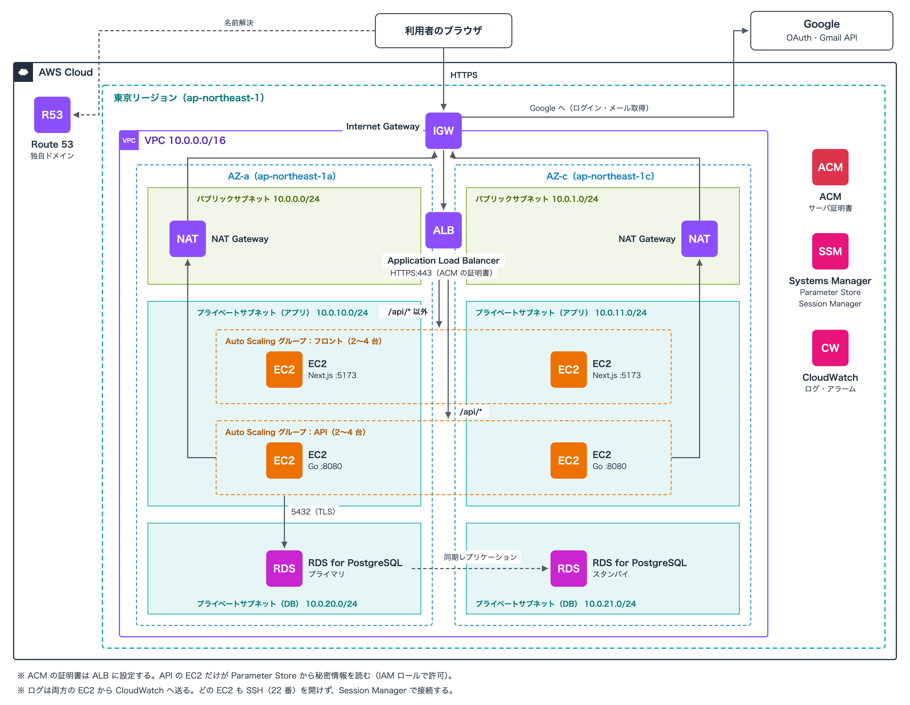

# インフラ構成（AWS）

種別: **生きた文書**（Step 8 の構築や、後の Step の変更に合わせて随時更新する。Step 7 の提出物は、提出時点のこの文書をもとにまとめる）

テーマ: [決済メール解析による自動家計簿サービス](./theme-kakeibo.md)
対象: Step 3 で実装したバックエンド（Go の API サーバ）と、Step 6 で実装したフロントエンド（Next.js）。メール取込の最小版（[mail-import-mvp.md](./mail-import-mvp.md)）を含む
位置づけ: Step 7（インフラ 1）の課題。**構成の設計まで**を扱い、構築は Step 8 で行う

> このドキュメントで決めること
> 1. **どの AWS サービスを使い、どう配置するか**（ネットワーク・冗長化・スケーリング）
> 2. **なぜそのサービスを選んだか**（比べた候補と、選ばなかった理由）
> 3. この構成にするために、**アプリ側で直しておくこと**（Step 8 の構築の前に）

---

## 0. 前提

### 0.1 課題の要件

| 種類 | 要件 | この構成での満たし方（詳細は 4 章） |
|---|---|---|
| 機能 | フロントをインターネット経由で配信できる | ALB を入口にして、Next.js のサーバへ振り分ける |
| 機能 | フロントからバックエンドの API を呼び出せる | ALB のパスルーティングで `/api/*` を API サーバへ振り分ける（同一オリジン） |
| 機能 | バックエンドのデータを永続化できる | RDS for PostgreSQL |
| 非機能 | 可用性：一部のサーバに障害が起きても応答し続ける | 全ての層を 2 つの AZ に置く。RDS は Multi-AZ |
| 非機能 | スケーリング：需要に合わせてサーバの台数を自動で増減する | フロントと API をそれぞれ Auto Scaling グループで動かす（2〜4 台） |

### 0.2 アプリの形（構成の決め方に効くもの）

| 部品 | 今の作り | 構成への影響 |
|---|---|---|
| フロント | Next.js 16。`next start` で動くサーバ（ポート 5173）。全画面が Client Component で、トークンはブラウザの sessionStorage に持つ | サーバ側に利用者ごとの状態が無いので、何台に増やしてもよい。ただし `/transactions/[id]` などの動的ルートと rewrites を使っているため、静的ファイルへの書き出し（`output: "export"`）はそのままではできない |
| API | Go（net/http）。ポート 8080。認証は JWT（署名を検証するだけで済む）。`GET /health` は DB への疎通まで確かめる | JWT はサーバ側に状態を持たないので台数を増やせる。ただし **OAuth の state と同期ジョブの管理に「1 台で動かす前提」の箇所が残っている**（→ 6 章） |
| メールの取込 | 「今すぐ同期」で API サーバの中で同期を始め、完了を待たずに返す（最大 10 分。[mail-import-mvp.md](./mail-import-mvp.md) 判断 4） | API サーバから Google（OAuth・Gmail API）へ、外向きの通信が要る |
| DB | PostgreSQL 17。スキーマは `cmd/migrate` の SQL で管理する | マネージドの PostgreSQL 17 を使えば、ローカルと同じ SQL がそのまま流せる |
| 同一オリジン | API は CORS ヘッダを返さない。フロントと API を同じオリジンで配信する前提（[API 仕様書](./step2-api-spec.md) 2 章 CORS。クラウドでは「ロードバランサのパスルーティングで振り分ける」と決めていた） | クラウドでも、フロントと API を 1 つのドメインで配信する必要がある |
| Google のログイン | コールバック URL を Google に登録する。Google は localhost 以外では **HTTPS の URL しか受け付けない** | 独自ドメインとサーバ証明書が要る |

### 0.3 環境

- AWS アカウント: Credit-tech の PoC 環境
- リージョン: 東京（ap-northeast-1）。AZ は 2 つ（以下 AZ-a・AZ-c）を使う

---

## 1. 構成の概要

（提出フォームの「概要」のもとにする）

- **入口は ALB 1 つ**。HTTPS で受け、パスで振り分ける（`/api/*` は API サーバ、それ以外はフロントのサーバ）。フロントと API が同じオリジンになるので、CORS の設定が要らない
- **フロント（Next.js）と API（Go）は、それぞれ EC2 の Auto Scaling グループ**で動かす。2 つの AZ に 1 台ずつ、計 2 台から始め、CPU 使用率に応じて 4 台まで増やす
- **DB は RDS for PostgreSQL の Multi-AZ**。プライマリが止まったら、別の AZ のスタンバイへ自動で切り替わる
- サーバと DB は**インターネットから直接届かないサブネット**に置く。外へ出る通信（Google への問い合わせ）は NAT Gateway を通す
- 秘密情報（DB のパスワード、署名鍵、Google の認証情報）は **Systems Manager Parameter Store** に置き、API の EC2 にだけ IAM ロールで読む権限を渡す

---

## 2. 構成図

提出フォームには、この画像（[step7-infra-diagram.png](./step7-infra-diagram.png)）を添付する。元の SVG は [step7-infra-diagram.svg](./step7-infra-diagram.svg)。

- AZ を縦の 2 列、サブネットを横の 3 段（パブリック／プライベート（アプリ）／プライベート（DB））にして描いている
- サービスのアイコンは、AWS のアイコンのカテゴリ色（ネットワークは紫、コンピュートは橙、データベースは赤紫、セキュリティは赤、管理は桃）の四角に、略称を書いたもので代用している
- フロントと API の EC2 は、それぞれ 1 つの Auto Scaling グループ（2 つの AZ にまたがる）。図は最小の 2 台の状態で、増えると各 AZ に 2 台ずつ（計 4 台）まで並ぶ
- ALB 自体は AWS が 2 つの AZ のパブリックサブネットに置く（ALB を作るときに、2 つの AZ のサブネットを指定する）。図では 2 つの AZ の間に描いている
- ACM・Parameter Store・CloudWatch との関係は、線が込み入るため図の下の注記に書いた（3.7・3.8）

---

## 3. 配置の詳細

### 3.1 ネットワーク（VPC・サブネット）

VPC は `10.0.0.0/16`。3 種類のサブネットを、2 つの AZ に 1 つずつ作る（計 6 つ）。

| サブネット | AZ-a | AZ-c | 置くもの | 外への経路（ルートテーブル） |
|---|---|---|---|---|
| パブリック | `10.0.0.0/24` | `10.0.1.0/24` | ALB、NAT Gateway | Internet Gateway |
| プライベート（アプリ） | `10.0.10.0/24` | `10.0.11.0/24` | EC2（フロント・API） | 同じ AZ の NAT Gateway |
| プライベート（DB） | `10.0.20.0/24` | `10.0.21.0/24` | RDS | なし（VPC の中だけ） |

- NAT Gateway は AZ ごとに置き、アプリのサブネットは**同じ AZ の NAT Gateway** を使う。1 つにすると、その AZ が止まったときに残りの AZ からも Google に届かず、ログインと同期ができなくなる（7.2）
- DB のサブネットには、インターネットへの経路を作らない

### 3.2 リクエストの流れ

| # | 経路 | 中身 |
|---|---|---|
| 1 | ブラウザ → Route 53 | 独自ドメインを ALB に解決する（エイリアスレコード） |
| 2 | ブラウザ → ALB（443） | HTTPS は ALB で終端する（証明書は ACM）。80 番は 443 へリダイレクトする |
| 3 | ALB → フロント（5173） | `/api/*` 以外。画面の HTML と JS を返す |
| 4 | ALB → API（8080） | `/api/*`。Google からのコールバック（`/api/v1/auth/google/callback`・`/api/v1/mail-accounts/google/callback`）もここに含まれる |
| 5 | API → RDS（5432） | TLS で接続する |
| 6 | API → NAT Gateway → Google | ログインの認可コードの交換と、Gmail API でのメールの取得 |

フロントのサーバは API を呼ばない（全画面が、ブラウザから API を呼ぶ）。そのため、ローカル開発で使っている Next.js の rewrites（`/api/*` を `localhost:8080` へ転送）は、クラウドでは通らない。

### 3.3 セキュリティグループ

| セキュリティグループ | 付ける先 | 受け付ける通信 |
|---|---|---|
| `sg-alb` | ALB | 443・80 を全てのアドレスから |
| `sg-web` | フロントの EC2 | 5173 を `sg-alb` からだけ |
| `sg-api` | API の EC2 | 8080 を `sg-alb` からだけ |
| `sg-db` | RDS | 5432 を `sg-api` からだけ |

- どの EC2 も 22 番（SSH）を開けない。サーバでの作業は Session Manager で行う（5 章）
- フロントの EC2 からは DB に届かない（`sg-db` は `sg-api` しか受け付けない）

### 3.4 ALB

| 項目 | 設定 |
|---|---|
| リスナー | HTTPS:443（ACM の証明書）／ HTTP:80（443 へリダイレクト） |
| ルール | パスが `/api/*` → `tg-api`、それ以外（既定）→ `tg-web` |
| アイドルタイムアウト | 既定の 60 秒。API はリクエストを最大 30 秒で打ち切る（`WriteTimeout`）ので足りる。時間のかかる同期は、完了を待たずに返す（202） |
| 登録解除の待ち時間 | 30 秒（既定は 300 秒）。台を外すときに、処理中のリクエストが終わるのを待つ時間。API のリクエストは 30 秒で終わるため |

| ターゲットグループ | ポート | ヘルスチェックのパス | 正常とする条件 |
|---|---|---|---|
| `tg-web` | 5173 | `/login` | 200 |
| `tg-api` | 8080 | `/health` | 200（DB に疎通できないと 503 を返す） |

ヘルスチェックは 30 秒間隔で、5 回続けて失敗したら異常とする（約 2 分半）。短くしない理由は 7.3。

### 3.5 EC2 と Auto Scaling

| 項目 | フロント | API |
|---|---|---|
| 起動テンプレート | Amazon Linux 2023、`t3.small` | Amazon Linux 2023、`t3.micro` |
| 台数（最小 / 希望 / 最大） | 2 / 2 / 4 | 2 / 2 / 4 |
| 置く場所 | プライベート（アプリ）のサブネット（AZ-a・AZ-c） | 同左 |
| スケーリングポリシー | ターゲット追跡：平均 CPU 使用率 50% | 同左 |
| ヘルスチェックの種類 | ELB（ALB が異常と判定した台を入れ替える） | 同左 |
| IAM ロール | `kakeibo-web-ec2` | `kakeibo-api-ec2` |

- 最小 2 台：1 台に障害が起きても、もう 1 台が応答できるようにする。2 つの AZ に 1 台ずつ配る
- 最大 4 台：想定する利用者は少ない。増やしすぎによる費用と、DB の接続数の上限（3.6）を抑える
- フロントを `t3.small`（メモリ 2 GiB）にするのは、Next.js（Node.js）が Go よりメモリを使うため。API は Go の実行ファイル 1 つなので `t3.micro`（1 GiB）で足りる
- 同じ Auto Scaling グループの台は、必ず同じビルドを動かす。Next.js はビルドごとに JS ファイルの名前が変わるため、ビルドの違う台が混ざると、画面の途中で JS の取得が 404 になる

### 3.6 RDS

| 項目 | 設定 |
|---|---|
| エンジン | PostgreSQL 17（ローカルの docker-compose と同じメジャーバージョン） |
| インスタンスクラス | `db.t4g.micro` |
| 配置 | Multi-AZ（プライマリと、別の AZ のスタンバイ）。DB サブネットグループは DB のサブネット 2 つ |
| ストレージ | gp3、20 GiB。保存時の暗号化を有効にする |
| バックアップ | 自動バックアップを 7 日分残す |
| パブリックアクセス | なし |
| 接続 | TLS 必須（RDS for PostgreSQL 15 以降は、既定で TLS 以外の接続を拒否する）。`DATABASE_URL` に `sslmode=require` を付ける |

- 接続数：API は 1 台あたり最大 25 本の接続を持つ（`SetMaxOpenConns(25)`）。最大の 4 台では 100 本になり、RDS の上限（インスタンスのメモリから自動で決まり、`db.t4g.micro` では 100 前後。Step 8 で `SHOW max_connections` で確かめる）に近い。アプリ側で上限を下げる（6 章 #3）
- 読み取り専用のレプリカは置かない。今の利用規模では、読み取りの負荷は問題にならない

### 3.7 秘密情報と IAM

Parameter Store（SecureString。暗号化の鍵は AWS 管理のキー）に置くもの:

| パラメータ | 中身 |
|---|---|
| `/kakeibo/prod/api/DATABASE_URL` | RDS への接続文字列（パスワードを含む） |
| `/kakeibo/prod/api/JWT_SECRET` | トークンの署名鍵 |
| `/kakeibo/prod/api/MAIL_CREDENTIAL_KEY` | メール連携の認証情報（リフレッシュトークン）を暗号化する鍵 |
| `/kakeibo/prod/api/GOOGLE_CLIENT_ID`・`GOOGLE_CLIENT_SECRET` | Google の OAuth クライアント |

- API の EC2 は起動時にこれらを読み、環境変数として API サーバに渡す（読み方は Step 8 で作る）
- 秘密ではない設定（`APP_ENV=production`、コールバック URL、戻り先の許可リストなど）は、起動テンプレートで渡す

IAM ロール（EC2 のインスタンスプロファイル）:

| ロール | 付与先 | 権限 |
|---|---|---|
| `kakeibo-api-ec2` | API の EC2 | Session Manager（`AmazonSSMManagedInstanceCore`）、CloudWatch へのログ送信、`/kakeibo/prod/api/*` の読み取りと復号 |
| `kakeibo-web-ec2` | フロントの EC2 | Session Manager、CloudWatch へのログ送信（秘密情報は読めない） |

- EC2 にアクセスキーを置かない。ロールの一時的な認証情報だけを使う
- フロントは秘密情報を使わないので、読む権限も渡さない

### 3.8 ログと監視（最小限）

| 対象 | 方法 |
|---|---|
| アプリのログ | API は JSON 形式のログを標準出力に書いている（slog）。CloudWatch エージェントで CloudWatch Logs に送る。EC2 を入れ替えるとサーバ上のログは消えるため |
| アラーム | ALB の 5xx の件数、ターゲットグループの正常な台数（1 台以下）、RDS の CPU 使用率と空き容量 |

監視の作り込みは Step 12（非機能要件）で行う。

---

## 4. 非機能要件の満たし方

### 4.1 可用性：どこが壊れたら、どう応答し続けるか

| 壊れたもの | 起きること | 応答し続けられる理由 |
|---|---|---|
| EC2 1 台（フロントか API） | その台が応答しなくなる | ALB のヘルスチェックで外れ、残りの台にだけ振られる。Auto Scaling グループが新しい台を起動して、2 台に戻す |
| AZ 1 つ | その AZ の EC2・NAT Gateway が止まる。RDS のプライマリがあればそれも止まる | ALB・EC2・NAT Gateway は残りの AZ で動き続ける。RDS はスタンバイに切り替わる。Auto Scaling グループは、残りの AZ で台数を補う |
| RDS のプライマリ | DB に読み書きできなくなる | Multi-AZ が自動でスタンバイに切り替える（1〜2 分）。**この間、API はエラーを返す**（7.3） |

### 4.2 スケーリング

| 層 | 増減のしかた |
|---|---|
| フロント・API | Auto Scaling グループのターゲット追跡。平均 CPU 使用率が 50% を超えたら増やし（最大 4 台）、下回ったら減らす（最小 2 台） |
| ALB | AWS が自動で増減する（設定は要らない） |
| DB | 自動では増えない。足りなくなったら、インスタンスクラスを上げる（Multi-AZ なら、止まるのは切り替えの間だけで済む） |

- 指標に CPU 使用率を選んだのは、フロントも API も負荷がかかると CPU が先に上がる作りのため（メモリを大きく使う処理が無い）
- リクエスト数（`RequestCountPerTarget`）でも追跡できるが、1 回のリクエストの重さが API によって違う（一覧の取得とメールの解析など）ので、CPU の方が実際の負荷に近い

---

## 5. 選定理由

| サービス | 役割 | 選んだ理由 | 比べた候補と、選ばなかった理由 |
|---|---|---|---|
| VPC | ネットワーク | サーバと DB をインターネットから切り離し、ALB だけを公開する。サブネットを「パブリック／アプリ／DB」に分け、ルートテーブルとセキュリティグループで届く範囲を層ごとに絞る | — |
| ALB | 入口・振り分け・HTTPS | ① パスで振り分けられるので、フロントと API を 1 つのドメインで配信でき、API 仕様書で決めた「同一オリジン・CORS なし」をそのまま保てる ② ヘルスチェックで壊れた台を外せる ③ ACM の証明書で HTTPS を終端できる | NLB：L4 で動くため、パスで振り分けられない |
| EC2 + Auto Scaling | フロント・API の実行 | ① 台数の増減と、壊れた台の入れ替えを自動にできる ② フロント（Node.js）と API（Go）を同じやり方で動かせ、運用の手順が 1 つで済む ③ 同期のように、リクエストを返した後も続く処理をそのまま動かせる | ECS（Fargate）：コンテナ化は後の Step で扱うため、今回は EC2 で組む。Lambda：同期を最大 10 分、リクエストを返した後も続ける今の作りに合わない |
| RDS for PostgreSQL（Multi-AZ） | DB | ① ローカルと同じ PostgreSQL 17 を使え、マイグレーションの SQL をそのまま流せる ② Multi-AZ で、障害時の切り替えが自動 ③ バックアップとパッチの適用を AWS に任せられる | EC2 に自分で PostgreSQL を入れる：切り替えとバックアップを自分で作る必要がある。Aurora：最小の構成でも RDS より高く、今の規模では性能の差が要らない |
| NAT Gateway | サーバから Google への外向きの通信 | サーバをプライベートサブネットに置いたまま、Google の API に届くようにする。AWS が管理するので、冗長化や更新の手間が無い | EC2 をパブリックサブネットに置く：NAT の費用は無くなるが、サーバにパブリック IP が付き、攻撃を受けうる範囲が広がる。NAT インスタンス：安いが、冗長化と更新を自分で行う必要がある |
| Route 53 | 独自ドメイン | ALB にエイリアスレコードで名前を付ける。ALB の IP アドレスは変わるが、エイリアスなら追従する | — |
| ACM | サーバ証明書 | Google のコールバック URL は HTTPS でないといけない。ACM なら無料で、更新も自動 | 自分で買った証明書：費用と、更新の手間がかかる |
| Systems Manager Parameter Store | 秘密情報の保管 | ① 秘密情報をコードや起動テンプレートに書かずに済む ② IAM で「API の EC2 だけが読める」と絞れる ③ 標準のパラメータは無料 | Secrets Manager：自動ローテーションができるが、今は使う予定が無く、1 件ごとに費用がかかる |
| Systems Manager Session Manager | サーバへのログイン | SSH の 22 番を開けず、踏み台サーバも鍵の管理も要らない。操作の記録も残せる | 踏み台サーバ + SSH：サーバが 1 台増え、鍵の管理が要る |
| IAM ロール | EC2 の権限 | アクセスキーをサーバに置かずに済む。フロントと API で、渡す権限を分けられる | — |
| CloudWatch | ログ・アラーム | EC2 を入れ替えても、ログが残る。異常に気づける | — |

---

## 6. 構成に合わせてアプリ側で直すこと（Step 8 の構築の前に）

今のバックエンドには、1 台で動かす前提の箇所が残っている（`auth.StateStore` のコメントにも「Step 7 以降で複数インスタンスに分散させる場合は（中略）共有ストアに置き換える必要がある」と書いていた）。2 台以上で動かすと、次の問題が起きる。

| # | 今の作り | 2 台以上にすると起きること | 直し方（案） |
|---|---|---|---|
| 1 | Google のログインとメール連携で使う state を、サーバのメモリに持つ（`auth.StateStore`） | ログインの開始とコールバックが別の台に振られると、コールバックを受けた台に state が無く、400 `INVALID_STATE` で失敗する。2 台なら、約半分のログインが失敗する | state を RDS のテーブルに置く。「10 分で失効」「1 回使ったら削除」という今の決まりは変えない（7.4） |
| 2 | 起動時に、「実行中」の同期ジョブを全て失敗にする（`RecoverInterrupted`） | ① 台が増えたとき（スケールアウト）に、他の台で動いている同期まで失敗として記録される ② 同期中の台が止まると（スケールイン・入れ替え）、ジョブが「実行中」のまま残り、どれかの台が次に起動するまで、その連携の同期が 409 `SYNC_ALREADY_RUNNING` で始められない | 起動時の一括の書き換えをやめ、「実行中のまま上限（10 分）を過ぎたもの」を中断とみなして、失敗に書き換える（同期を始める前の確認で行う） |
| 3 | DB の接続の上限が 25 本で固定（`SetMaxOpenConns(25)`） | 最大の 4 台で 100 本になり、RDS の上限に近い | 環境変数で変えられるようにし、本番は 15 本にする（4 台で 60 本） |
| 4 | 同期の二重起動を、サーバのメモリ上のロックで防ぐ（`startMu`） | 2 台に同時に「今すぐ同期」が届くと、両方で始まりうる（取り込んだメールは UNIQUE 制約で 1 件にしかならないので、実害は小さい） | DB の部分 UNIQUE インデックス（`sync_jobs(mail_account_id) WHERE status = 'running'`）で防ぐ |
| 5 | ローカルの `DATABASE_URL` は `sslmode=disable` | RDS は TLS 以外の接続を拒否するので、繋がらない | 本番の `DATABASE_URL` を `sslmode=require` にする（コードの変更は無い） |

---

## 7. 検討したこと

### 7.1 フロントの置き場所

| 案 | よい点 | 困る点 | 判断 |
|---|---|---|---|
| A. EC2 + Auto Scaling（API と同じ ALB の後ろ） | 同一オリジンをそのまま保てる。API と同じ仕組みで冗長化・スケーリングでき、必須講座の範囲で組める | サーバの OS の管理が要る。静的ファイルも EC2 が返す | **採用** |
| B. Amplify Hosting | サーバの管理が要らない。Git に push するとデプロイされる | API は別に ALB で公開する必要があり、入口が 2 つになる。同一オリジンにするには、Amplify の転送設定で `/api/*` を ALB に回す必要がある。Next.js 16 への対応も確かめる必要がある | 不採用 |
| C. S3 + CloudFront（静的ファイルとして書き出す） | 最も安く、アクセスが増えても強い。CloudFront で `/api/*` を ALB に振れば、同一オリジンも保てる | `/transactions/[id]` などの動的ルートが、静的ファイルへの書き出しではそのまま使えない（画面の URL の作りを変える必要がある） | 不採用。アクセスが増えたときの候補にする |

### 7.2 NAT Gateway を AZ ごとに置くか

1 つにすれば、月 45 ドルほど安くなる。ただしその AZ が止まると、残りの AZ の API からも Google に届かなくなり、ログインと同期ができない。可用性の要件を満たすため、AZ ごとに置く。

Step 8 の構築中（動作を確かめる段階）は、1 つで始めて費用を抑える選択肢もある（10 章 #5）。

### 7.3 ヘルスチェックに DB への疎通を含めるか

API の `/health` は、DB に疎通できないと 503 を返す（壊れた台にリクエストを流し続けないため。Step 3 で決めた）。ただしこのままだと、RDS の切り替え（1〜2 分）の間に**全ての API の台が異常と判定され、Auto Scaling グループが全台を入れ替えてしまう**おそれがある。入れ替えた台が起動するまで、DB が戻った後も応答できない。

→ 判定を「30 秒間隔で 5 回続けて失敗」（約 2 分半）とし、RDS の切り替えにかかる時間より長くする。なお、全ての台が異常になったとき、ALB は判定を無視して全ての台にリクエストを振るので、ALB の段階で全て止まることは無い。

| 案 | 判断 |
|---|---|
| 判定までの時間を、RDS の切り替えより長くする | **採用** |
| Auto Scaling グループの判定を EC2 の状態だけにする（ALB の判定を使わない） | 不採用。DB の障害で入れ替えは起きなくなるが、アプリが固まった台も入れ替わらなくなる |

### 7.4 OAuth の state の置き場所（6 章 #1）

| 案 | 判断 |
|---|---|
| RDS のテーブル | **採用**。サービスを増やさずに済み、台の入れ替えにも影響されない |
| ElastiCache（Redis） | 不採用。期限付きのデータの置き場所には向いているが、量は少なく（ログイン 1 回で 1 件、10 分で消える）、サービスを 1 つ増やす（費用と、Redis 自体の冗長化）ほどではない |
| ALB のスティッキーセッション（同じ利用者を同じ台に振る） | 不採用。コードを変えずに済むが、台が入れ替わると state が消える。またメール連携の開始は画面からの fetch のため、cookie が付くかどうかに頼ることになる |

### 7.5 同期を API サーバの中で動かし続けるか

今は「今すぐ同期」の手動の同期だけで、時間は最大 10 分。台が減るとき（スケールイン）や入れ替えのときに途中で止まりうるが、もう一度同期すれば取りこぼし無く取り込める（期間を 24 時間重ねて取り、重複は UNIQUE 制約で 1 件になる）。そのため今回は、API サーバの中で動かし続ける（止まったジョブの扱いは 6 章 #2 で直す）。

定期的な同期（1 分間隔）を入れるときは、同期を API から切り離し、専用の実行基盤（EventBridge Scheduler と ECS のタスクなど）にする（[パイプライン](./step0-pipeline.md) 6 章 未決事項 6）。

---

## 8. 費用の目安

東京リージョン・オンデマンド・1 か月（730 時間）。公開価格からの概算で、Step 8 の前に AWS Pricing Calculator で確かめる。

| サービス | 数量 | 月額の目安（USD） |
|---|---|---|
| ALB | 1 | 約 18（＋処理量に応じた料金） |
| EC2 `t3.small`（フロント） | 2 台 | 約 40 |
| EC2 `t3.micro`（API） | 2 台 | 約 20 |
| NAT Gateway | 2 | 約 90（＋通信量） |
| パブリック IPv4 アドレス | 4（ALB 2・NAT Gateway 2） | 約 15 |
| RDS `db.t4g.micro` Multi-AZ | 1 | 約 37 |
| RDS ストレージ（gp3 20 GiB、Multi-AZ） | — | 約 6 |
| Route 53 | ホストゾーン 1 | 約 0.5（＋ドメインの費用） |
| Parameter Store（標準）・ACM | — | 0 |
| **合計** | | **約 230（1 日あたり約 7.5）** |

- 一番大きいのは NAT Gateway。ALB と NAT Gateway は、使っていなくても時間で課金される
- Step 8 で構築したら、使わない期間は削除・停止する

---

## 9. この構成のメリット・デメリット

（メンタリングの「提出課題の説明」のもとにする）

**メリット**

- どの層も 2 つの AZ にあり、サーバ 1 台や AZ 1 つの障害では止まらない
- 入口が ALB 1 つで、フロントと API が同一オリジン。CORS の許可リストを管理しなくてよく、その設定ミスによる事故も起きない
- インターネットから届くのは ALB だけ。サーバと DB は直接届かない場所にあり、SSH も開けない
- 必須講座で扱ったサービスが中心で、仕組みを自分で説明できる

**デメリット（リスク）**

- 費用：利用者が少ない段階でも、月 230 ドル程度かかる。特に NAT Gateway が大きい
- RDS の切り替えの 1〜2 分は、API がエラーを返す（画面はエラー表示になる）
- EC2 の OS の更新と、デプロイの手順を自分で持つ必要がある
- 同期が API サーバの中で動くため、台が減るとき・入れ替えのときに同期が途中で止まりうる（もう一度同期すれば取り戻せる）
- DB は自動では増えない

---

## 10. 未決事項（講師に相談する・Step 8 で決める）

| # | 内容 | 決めないと困ること |
|---|---|---|
| 1 | ドメイン：PoC 環境で使えるドメインがあるか（Route 53 で新しく取るか、社内のドメインの一部を使わせてもらうか） | HTTPS の証明書と、Google のコールバック URL が作れない |
| 2 | Google の OAuth クライアントに、本番のコールバック URL（`https://<ドメイン>/api/v1/auth/google/callback` など 2 つ）を登録する | ログインとメール連携ができない |
| 3 | デプロイの方法：ビルドしたものを EC2 にどう載せるか（AMI に焼き込む／起動時に S3 から取る） | 台が増えたときに、新しい台が同じビルドで動かない |
| 4 | マイグレーションの実行場所：Session Manager で API の台に入り、`cmd/migrate up` を流すか | RDS にテーブルが作れない |
| 5 | PoC 環境の予算の上限 | NAT Gateway を 1 つにするかどうか（7.2） |
