# Step 8 提出物

種別：**スナップショット**（Step 8 提出時点で固定し、以降は更新しない）。その後の変更は、次の Step 以降の提出物の 0 章に記録する

> **下書き**：【要記入】（スクリーンショット・実行結果・構築中の出来事）を埋めてから提出する。提出前にこの注記を消す

サービス名：決済メール解析による自動家計簿サービス
リポジトリ：<https://github.com/e1lite/devcamp-kakeibo>
公開 URL：<https://app.autokakeibo.com>（費用を抑えるため、普段はサーバを止めている。メンタリングで見せるときに起動する）

| 提出項目 | 場所 |
|---|---|
| 概要 | 本ファイルの ① |
| インフラ構成図 | 本ファイルの ②（画像は [docs/step8-infra-diagram.png](./step8-infra-diagram.png)。提出フォームに添付する） |
| 動作確認 | 本ファイルの ③（スクリーンショットは [docs/step8-screenshots/](./step8-screenshots/)） |
| 机上確認 | 本ファイルの ④ |
| まとめ | 本ファイルの ⑤ |
| 構成の設計と、構築した形の詳細 | [docs/step7-infra.md](./step7-infra.md)（Step 8 で構築した形は 11 章） |

---

## 0. 前の Step からの変更

### A. アプリ側の修正（Step 7 の 6 章、4 件とも実装済み）

API サーバを Auto Scaling グループで複数台にすると成り立たなくなる「1 台で動かす前提」の箇所を、構築の前に直した。

| # | 修正 | 直さないと起きること |
|---|---|---|
| 1 | Google ログインの `state` を、サーバのメモリから DB（新しいテーブル `oauth_states`）に移す。取り出しと削除を 1 つの SQL（`DELETE ... RETURNING`）で行い、同じ `state` は 1 回しか使えない | ログインの開始とコールバックが別の台に振られると、ログインが失敗する |
| 2 | 中断された同期の判定を、「起動時に実行中のものを全部失敗にする」から「実行中のまま 11 分を過ぎたもの」に変える | 1 台が起動し直すたびに、別の台で実行中の同期まで失敗にしてしまう |
| 3 | 同期の二重起動を、メモリ上のロックではなく DB の部分 UNIQUE インデックス（`uq_sync_jobs_running`）で防ぐ | 別々の台で同じ連携の同期が同時に走る |
| 4 | DB の接続数の上限を環境変数 `DB_MAX_OPEN_CONNS` で変えられるようにする（既定 25、本番 15） | 台数を増やしたとき、接続数の合計が RDS（`db.t4g.micro`）の上限を超える |

マイグレーションは 000012・000013 の 2 つを追加した（[DB 仕様書](./step2-db-spec.md)・[ER 図](./step2-er.md)に反映）。単体テスト・統合テスト・静的解析はすべて成功。

### B. 構築のために追加したもの

| 追加したもの | 内容 |
|---|---|
| [scripts/build-release.sh](../scripts/build-release.sh) | S3 に置く成果物を作る。API は Arm（t4g）向けの実行ファイルとマイグレーション一式（`api.tar.gz`、約 8 MB）。フロントは Docker の `linux/arm64` のコンテナで作る Next.js の standalone 一式と Node.js 24 の本体（`web.tar.gz`、約 54 MB） |
| [deploy/userdata-api.sh](../deploy/userdata-api.sh)・[userdata-web.sh](../deploy/userdata-web.sh) | 起動テンプレートのユーザーデータ。S3 から成果物を取り、API は Parameter Store から秘密情報を読んで、systemd で常駐させる。起動時のログとアプリのログを CloudWatch Logs に送る |
| [deploy/migrate.sh](../deploy/migrate.sh) | Session Manager で API の EC2 に入り、`sudo /opt/kakeibo/api/migrate.sh up` でマイグレーションを流す |
| Next.js の `output: "standalone"` | 動かすのに必要なファイルだけを配り、成果物を小さくして起動を速くする（Step 7 のフィードバック：起動時間への留意） |

### C. Step 7 のフィードバックへの対応

| フィードバック | 対応 |
|---|---|
| 回答 1：ドメインは、無いと進まない部分が出たら相談 | 全画面が Google ログインを前提にしており、Google は HTTPS のコールバック URL しか受け付けない。ALB の既定のドメインには ACM の証明書を発行できないため、**自費で `autokakeibo.com` を取得**し、PoC 環境の Route 53 で管理した |
| 回答 2：開発と本番で OAuth クライアントを分ける | 本番用のクライアントを別に作り、`https://app.autokakeibo.com` の 2 つのコールバック URL を登録した。本番の client_secret は Parameter Store にだけ置いた |
| 回答 3：デプロイはユーザーデータで S3 から取る案から。Next.js の成果物の大きさに留意 | そのとおりにした（0 章 B）。Next.js は standalone にし、Node.js の本体も同梱して EC2 への Node.js のインストールを省いた |
| 回答 4：マイグレーションは Session Manager で API の台に入って流す。誰がいつ実行したかを残せる | そのとおりにした。誰がいつ入ったかは Session Manager のセッション履歴に残り、実行したコマンドと出力も CloudWatch Logs に記録するよう設定した |
| 回答 5：予算は遠藤さんに確認。AWS Budgets で月額のアラート | 【要記入：遠藤さんへの確認結果】。費用を設計の約半分に抑えた形で構築した（① の「Step 7 から調整した部分」）。AWS Budgets で月額のアラートを設定した（【要記入：金額】ドル） |
| Tips：CloudWatch Logs の保持期間 | ロググループ `/kakeibo/api`・`/kakeibo/web` の保持期間を 30 日にした |
| Tips：ALB のアクセスログを S3 に | ALB のアクセスログを S3 のバケットに保存するようにした |

---

## ① 概要

### 構成の特徴

- **入口は ALB 1 つ**。HTTPS（`app.autokakeibo.com`、ACM の証明書）で受け、パスで振り分ける。`/api/*` と `/health` は API のサーバ、それ以外はフロントのサーバ。フロントと API が同じオリジンになるため、CORS の設定が要らない。HTTP は HTTPS へリダイレクトする
- **フロント（Next.js）と API（Go）は、それぞれ EC2 の Auto Scaling グループ**で動かす。2 つの AZ のサブネットにまたがり、平時は 1 台、CPU 使用率 50% を目安に 4 台まで自動で増やす
- **DB は RDS for PostgreSQL 17**（暗号化あり、インターネットからの接続なし）
- サーバと DB は**インターネットから直接届かないプライベートサブネット**に置く。Google への外向きの通信は NAT Gateway、S3 からの成果物の取得は S3 のゲートウェイエンドポイントを通す（NAT を通らない）
- 秘密情報（DB の接続文字列、署名鍵、Google の認証情報）は **Parameter Store** に置き、API の EC2 の IAM ロールにだけ読む権限を渡す。SSH のポートは開けず、サーバには Session Manager で入る
- **デプロイ**は、成果物を S3 に置き、EC2 の起動時にユーザーデータで取得する。新しい版は Auto Scaling グループの「インスタンスの更新」で入れ替える（新しい台が正常になってから古い台を消すため、止まらない）

### 採用したサービス

| サービス | 用途 | 主な設定 |
|---|---|---|
| VPC | ネットワーク | `10.0.0.0/16`。2 つの AZ × 3 層（パブリック・アプリ・DB）の 6 サブネット |
| Elastic Load Balancing（ALB） | 入口・パスによる振り分け | HTTPS:443（ACM）。`/api/*`・`/health` → API、既定 → フロント。HTTP:80 → 443 へリダイレクト |
| EC2・Auto Scaling | フロントと API のサーバ | Amazon Linux 2023（arm64）、`t4g.micro`、IMDSv2 必須。1〜4 台、CPU 50% の目標追跡 |
| RDS for PostgreSQL | DB | PostgreSQL 17、`db.t4g.micro`、単一 AZ、gp3 20 GiB、暗号化 |
| NAT Gateway | サーバから Google への外向きの通信 | AZ-a に 1 つ |
| S3・VPC エンドポイント（ゲートウェイ） | 成果物（`api.tar.gz`・`web.tar.gz`）の置き場所 | パブリックアクセスはすべてブロック。EC2 からは NAT を通らずに取得 |
| Route 53・ACM | 独自ドメインと HTTPS の証明書 | `app.autokakeibo.com` → ALB（エイリアス） |
| Systems Manager | 秘密情報（Parameter Store）、サーバへの接続（Session Manager） | `/kakeibo/prod/api/*`（SecureString） |
| IAM | EC2 に渡す権限 | API とフロントで別のロール。秘密情報を読めるのは API だけ |
| CloudWatch Logs | 起動時のログとアプリのログ | `/kakeibo/api`・`/kakeibo/web`、保持 30 日 |

### Step 7 から調整した部分

**(1) 費用を抑えるために縮小したもの（4 件）**

費用を設計の約半分（月約 215 ドル → 約 111 ドル）にするため、次の 4 点を縮小して構築し、動作確認もこの形で行った。ネットワーク（2 つの AZ・6 サブネット）、ALB、Auto Scaling グループの「2 つの AZ にまたがる・CPU で増減する」設定は設計のまま残し、**設定を変えるだけで設計の形に戻せる**ようにしている（手順は [step7-infra.md 11.3](./step7-infra.md)）。

| 項目 | 設計（Step 7） | 構築した形 | 理由 |
|---|---|---|---|
| NAT Gateway | AZ ごとに 1 つ（計 2 つ） | AZ-a に 1 つ | 使わなくても時間で課金され、一番費用が大きい（月約 45 ドル減） |
| 台数（最小 / 希望 / 最大） | 2 / 2 / 4 | 1 / 1 / 4 | 費用。利用者が自分だけの段階では 1 台で足りる |
| フロントのインスタンス | `t4g.small` | `t4g.micro` | 費用。standalone で動かす Next.js は数百 MB のメモリで足りる |
| RDS | Multi-AZ | 単一 AZ | 費用（月約 21 ドル減） |

縮小した分、障害に弱くなる（⑤ の後の「メンタリング報告」のデメリット）。

**(2) 構築にあたって設計に足したもの・変えたもの**

| 項目 | 内容 | 理由 |
|---|---|---|
| ALB の `/health` のルール | `/health` も API のサーバへ振り分ける | `/health` は `/api/*` の下に無く、設計のままではフロントに届いて 404 になる。外から curl で疎通を確かめられない |
| S3 と、S3 のゲートウェイエンドポイント | 成果物の置き場所。EC2 からは NAT を通らずに取る | デプロイの方式（講師の回答 3）で必要になった。エンドポイントは無料で、NAT の通信料もかからない |
| EC2 の種類 | `t3` → `t4g`（Arm） | 同じ大きさで約 2 割安い。成果物も Arm 向けに作る |
| 独自ドメイン | `autokakeibo.com`（自費で取得） | Google ログインに HTTPS のコールバック URL が要るため（0 章 C） |
| ロググループの保持期間 | 30 日 | 講師の Tips。既定は無期限 |

### 費用

| 形 | 月額の目安 | 1 日あたり |
|---|---|---|
| 設計の形（Step 7） | 約 215 ドル | 約 7 ドル |
| 構築した形（動かしているとき） | 約 111 ドル | 約 3.7 ドル |
| 止めているとき（ALB とホストゾーンなどが残る） | — | 約 1 ドル |

使わないときは、Auto Scaling グループの台数を 0 にし、RDS を一時停止し、NAT Gateway を削除して Elastic IP を解放する。再開は 15 分ほど（[step7-infra.md 11.4](./step7-infra.md)）。

---

## ② インフラ構成図

構築後の最終的な構成。点線の枠は、今は動かしていないもの（設定を変えると加わるもの）。提出フォームには [step8-infra-diagram.png](./step8-infra-diagram.png) を添付する（元の SVG は [step8-infra-diagram.svg](./step8-infra-diagram.svg)）。

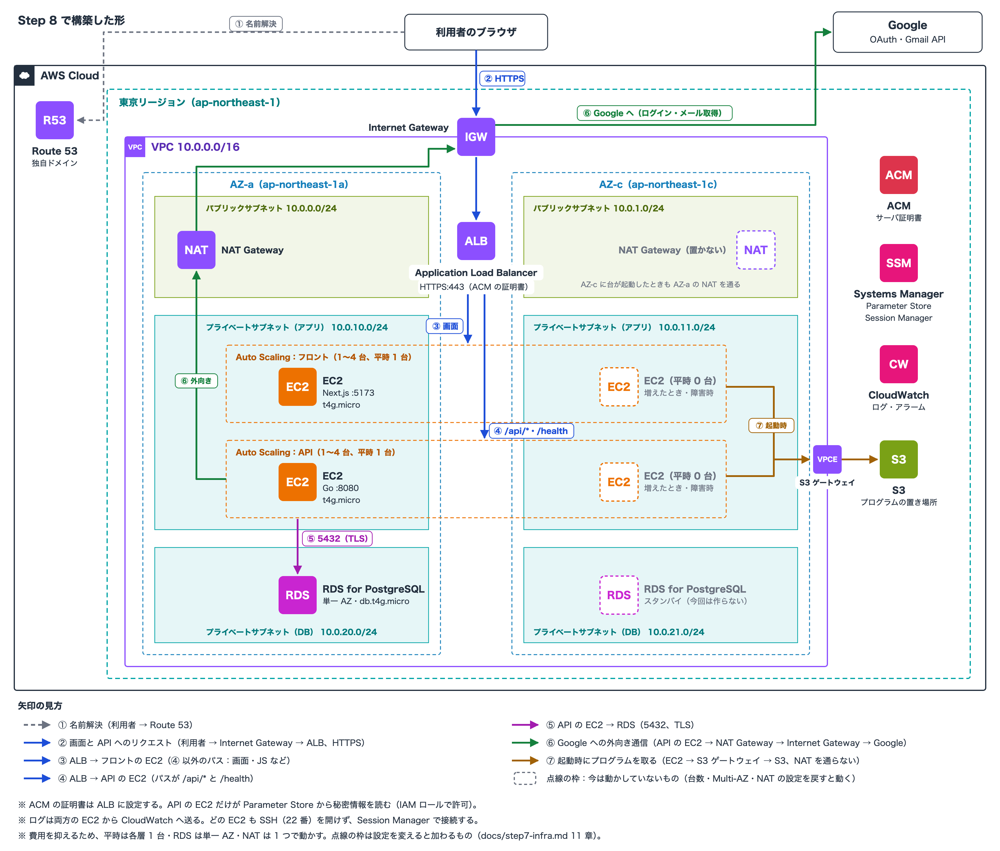

---

## ③ 動作確認

### 1. curl によるバックエンドの疎通確認

```
$ curl -i https://app.autokakeibo.com/health
HTTP/2 200
date: Wed, 11 Nov 2026 03:44:18 GMT
content-type: application/json; charset=utf-8
content-length: 97

{"data":{"status":"ok","version":"0c2950c","database":"ok","checked_at":"2026-11-11T03:44:18Z"}}
```

`/health` は DB への疎通まで確かめ、つながらなければ `503` を返す。`version` は動いている API をビルドした時点のコミット（`0c2950c`）で、0 章 A の修正（コミット `2c16697`）を含む版が配られていることもここで確かめた。

あわせて次も確かめた。

| コマンド | 確かめたこと | 結果 |
|---|---|---|
| `curl -i http://app.autokakeibo.com/health` | HTTP は HTTPS へリダイレクトされる | `301 Moved Permanently`、`Location: https://app.autokakeibo.com:443/health`（`Server: awselb/2.0`。ALB がリダイレクトしている） |
| `curl -i https://app.autokakeibo.com/api/v1/auth/me` | API がインターネット経由で応答し、トークンが無ければ拒む | `401`、`{"error":{"code":"INVALID_TOKEN","message":"Authorization ヘッダが不正です"}}`（API 仕様書のエラーの形） |
| `curl -sI https://app.autokakeibo.com/login` | フロント（Next.js）がインターネット経由で応答する | `200`、`content-type: text/html`、`x-powered-by: Next.js`（事前描画したログイン画面を Next.js のサーバが返している） |

### 2. ブラウザ操作

`https://app.autokakeibo.com` を開き、Google ログインから Step 5 の画面レイアウト・イベント設計のとおりに操作した。
スクリーンショットは、Step 6 と同じく、ログインで得たトークンを使ってヘッドレスの Chrome で同じ操作をして撮った（[scripts/take-screenshots.sh](../scripts/take-screenshots.sh)）。
一覧が空にならないよう手入力の取引 3 件を足してから撮り、撮ったあと、足した取引と操作で作った取引・カテゴリを削除した。画面上のメールアドレスは伏せ字にしている。

| # | 画面・操作 | 確認したこと（Step 5 の設計） | 呼ばれる API | スクリーンショット |
|---|---|---|---|---|
| 1 | SCR-002 ログイン | 公開 URL で表示され、Google ログインへ進める | API-002 | [01-login.png](./step8-screenshots/01-login.png) |
| 2 | SCR-010 取引一覧 | ログイン後、当月の件数・合計・一覧が出る。メールから取込んだ取引には「速報」の印 | API-004・010・019・031 | [02-list.png](./step8-screenshots/02-list.png) |
| 3 | SCR-011 取引登録 | 入力して登録 → 登録した月の一覧と「✓ 登録しました」。件数・合計に反映される | API-011 | [03-new.png](./step8-screenshots/03-new.png)・[04-list-created.png](./step8-screenshots/04-list-created.png) |
| 4 | SCR-012 取引詳細 | 登録した取引の金額・曜日つきの日時・未分類・手入力 | API-012 | [05-detail.png](./step8-screenshots/05-detail.png) |
| 5 | SCR-013 取引編集 | カテゴリを変えると「保存」を押せる → 保存 → 詳細に「✓ 保存しました」と、カテゴリに「手動」の印 | API-013 | [06-edit.png](./step8-screenshots/06-edit.png)・[07-detail-saved.png](./step8-screenshots/07-detail-saved.png) |
| 6 | SCR-012 削除 | 日時・店舗・金額を示す確認のダイアログ → 削除 → 一覧に戻り「✓ 削除しました」 | API-014 | [08-detail-delete.png](./step8-screenshots/08-detail-delete.png)・[09-list-deleted.png](./step8-screenshots/09-list-deleted.png) |
| 7 | SCR-020 カテゴリ管理 | 画面から追加したカテゴリが「✓ 追加しました」とともに一覧に出る | API-019・020 | [10-categories.png](./step8-screenshots/10-categories.png) |
| 8 | （拡張）SCR-050 メール連携 | 連携中の Gmail（アドレスは伏せ字）、最終同期と最新の同期結果（成功、取得 37 件） | API-006・009 | [11-mail-accounts.png](./step8-screenshots/11-mail-accounts.png) |

画面の操作で呼ばれた API（メソッド・パス・ステータス）は、撮影のときに [api-log.txt](./step8-screenshots/api-log.txt) に記録した（全 42 件、すべて成功）。主な操作の行を抜き出すと次のとおりで、画面の操作ごとに `app.autokakeibo.com/api/v1/...` が呼ばれ、データが更新されている。

```
# 操作            メソッド パス                                                      ステータス
02 取引一覧       GET    /api/v1/transactions?from=2026-11-01&to=2026-11-11&limit=20&offset=0   200
03 取引登録       POST   /api/v1/transactions                                         201
06 取引編集       PUT    /api/v1/transactions/144                                     200
08 取引削除       DELETE /api/v1/transactions/144                                     204
10 カテゴリ管理   POST   /api/v1/categories                                           201
11 メール連携     GET    /api/v1/mail-accounts                                        200
```

### 3. データの参照・更新が DB に反映されること

| 確認したこと | 結果 |
|---|---|
| 登録・削除が、取り直した一覧の件数と合計に反映される | 14 件・¥35,551（02）→ 登録のあと 15 件・¥36,751（04）→ 削除のあと 14 件・¥35,551（09）。どれも登録・削除のあとに API から一覧を取り直した結果 |
| 編集が、取り直した詳細に反映される | 保存のあと詳細を取り直し、カテゴリが「食費（手動）」になっている（07） |
| 別のブラウザでも同じデータが見える（ブラウザではなく RDS に保存されている） | 撮影は、ログインに使ったブラウザとは別のヘッドレスの Chrome で行った。そこでも、前もってメール連携で取り込んだ取引（02 の「速報」の行）と同期の履歴（11）が見える |

### スクリーンショット

#### 1. SCR-002 ログイン

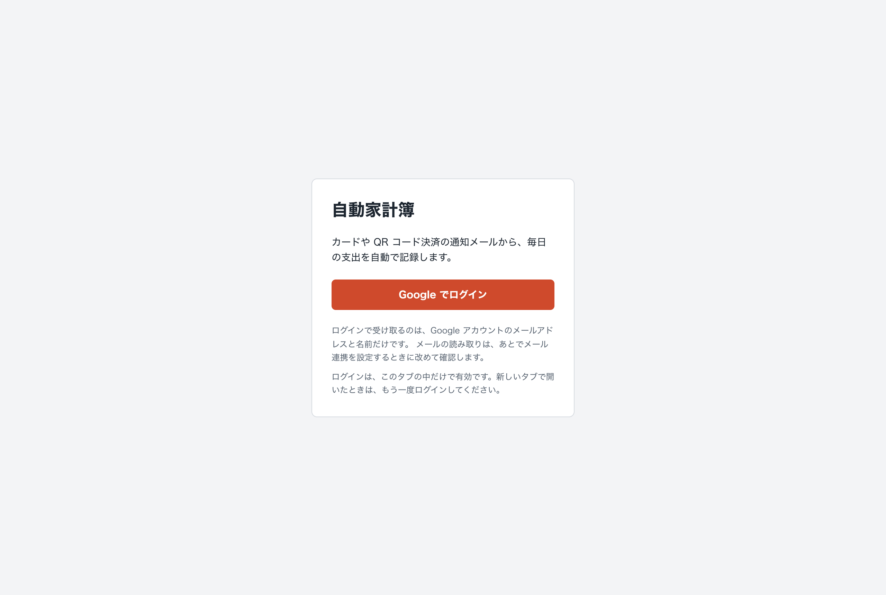

#### 2. SCR-010 取引一覧

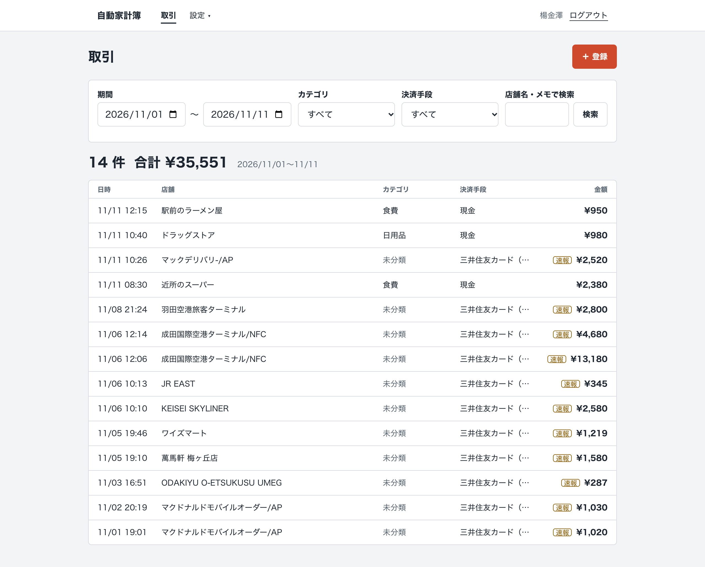

#### 3. SCR-011 取引登録（入力したところ）

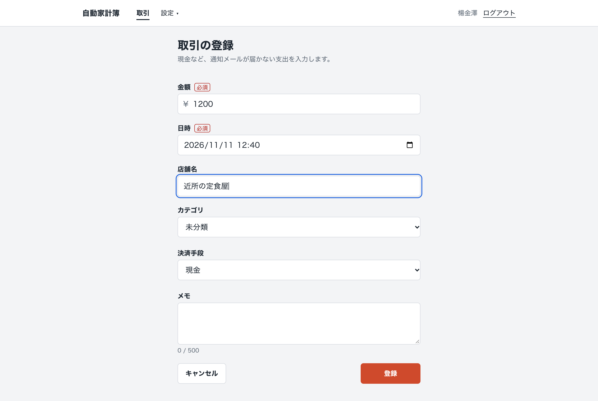

#### 4. SCR-010 登録のあと

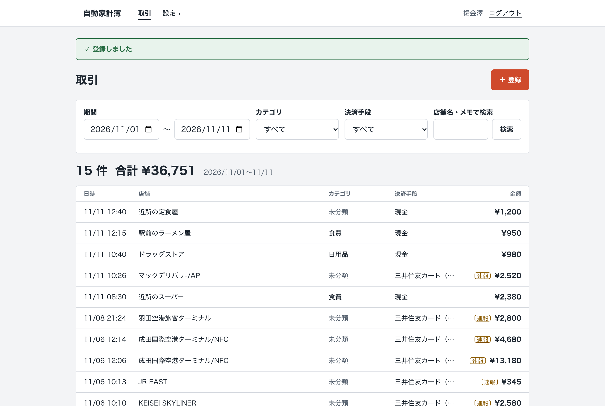

#### 5. SCR-012 取引詳細

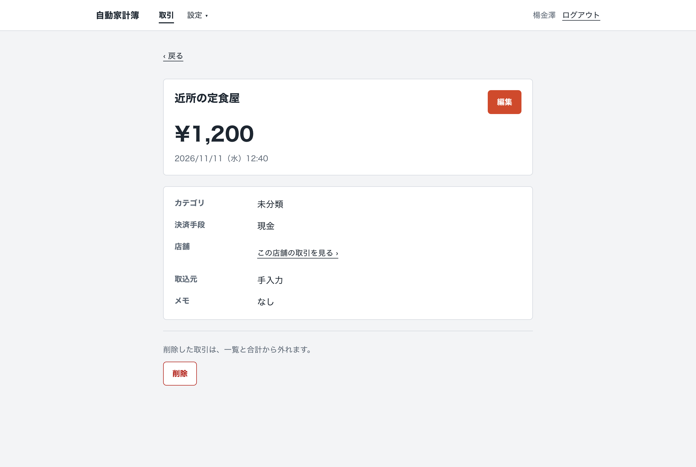

#### 6. SCR-013 取引編集（カテゴリを変えたところ）

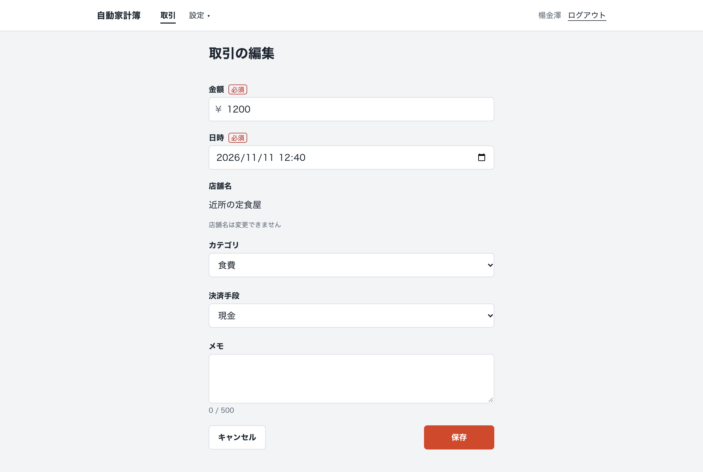

#### 7. SCR-012 保存のあと

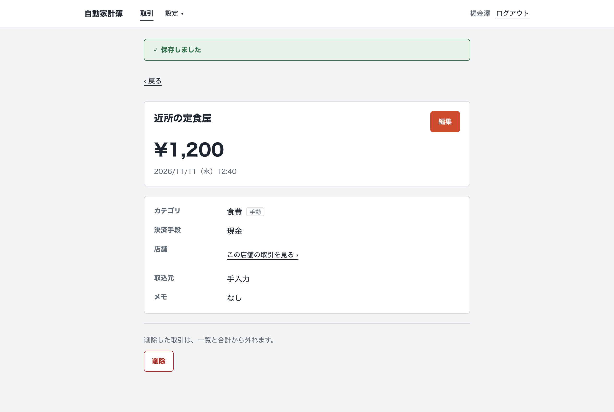

#### 8. SCR-012 削除の確認

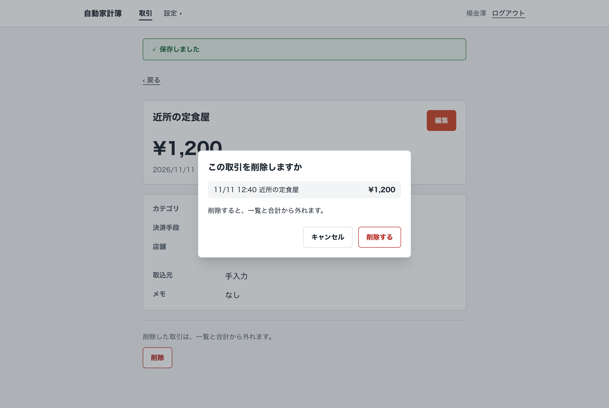

#### 9. SCR-010 削除のあと

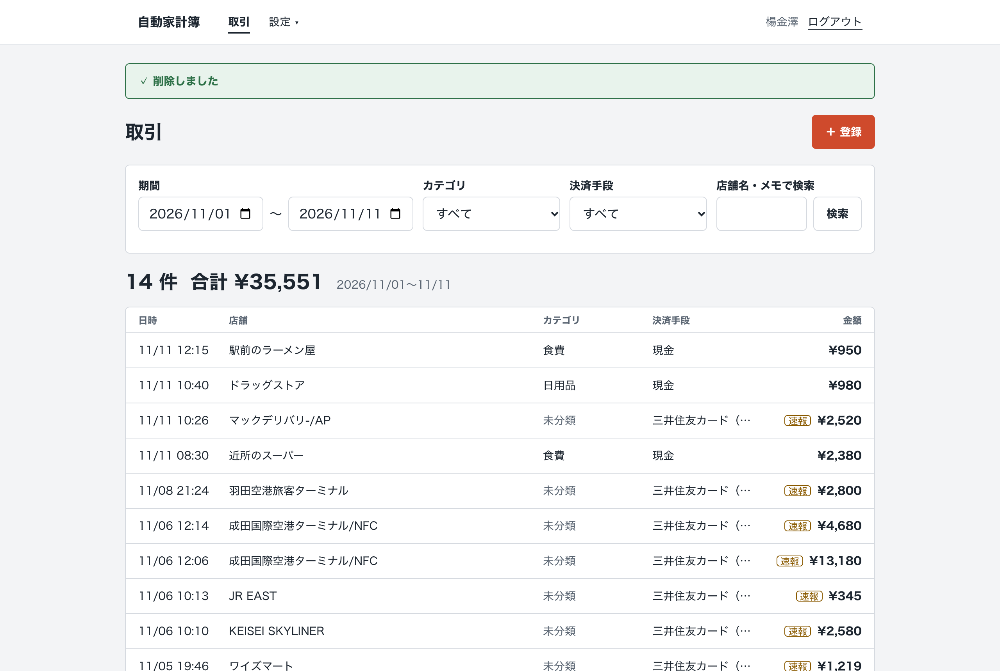

#### 10. SCR-020 カテゴリ管理（画面から追加したあと）

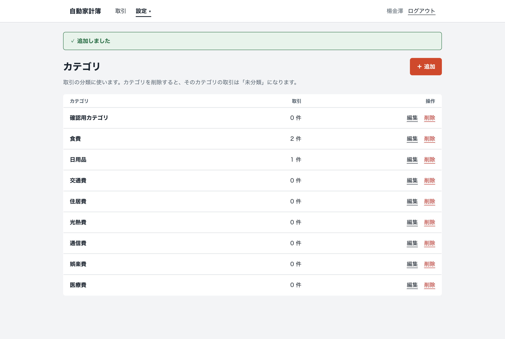

#### 11. （拡張）SCR-050 メール連携

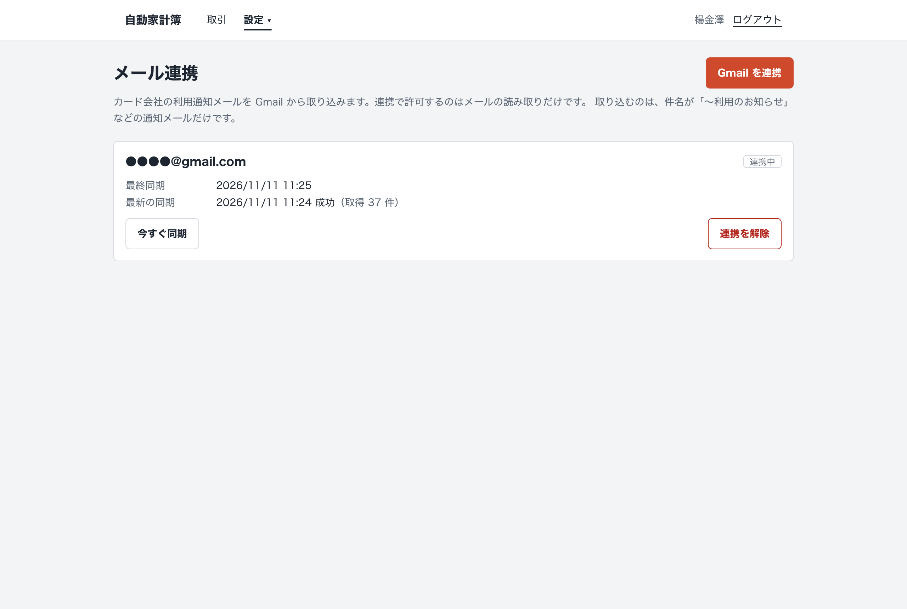

---

## ④ 机上確認

Step 7 で設計した構成が反映されていることを、AWS のコンソールで確かめた。スクリーンショットではアカウント ID とメールアドレスを伏せ、Parameter Store は名前だけを写している。

| # | 設計（[step7-infra.md](./step7-infra.md)） | 確認した画面 | 確かめたこと | スクリーンショット |
|---|---|---|---|---|
| 1 | 3.1 ネットワーク | VPC の「リソースマップ」 | 2 つの AZ × 3 層の 6 サブネット。パブリックのサブネットは `kakeibo-rtb-public` から Internet Gateway へ、アプリのサブネットは 2 つで 1 つのルートテーブル（`kakeibo-rtb-app`）から NAT Gateway（1 つ）と S3 のゲートウェイエンドポイントへつながる | [21-vpc-resource-map.png](./step8-screenshots/21-vpc-resource-map.png) |
| 2 | 3.4 ALB・ターゲットグループ | ロードバランサーの「リソースマップ」 | リスナーは HTTPS:443 と HTTP:80。HTTPS のルールは `/api/*`（優先度 10）・`/health`（優先度 20）→ `kakeibo-tg-api`、既定 → `kakeibo-tg-web`。HTTP は HTTPS へリダイレクト。両方のターゲットグループのターゲットが「正常」 | [22-alb-resource-map.png](./step8-screenshots/22-alb-resource-map.png) |
| 3 | 3.5 Auto Scaling | Auto Scaling グループの一覧 | `kakeibo-asg-web`・`kakeibo-asg-api` の 2 つ。希望 1・最小 1・最大 4、2 つの AZ、インスタンスは 1/1 正常 | [23-asg-list.png](./step8-screenshots/23-asg-list.png) |
| 4 | 3.3 セキュリティグループ | `kakeibo-sg-db` のインバウンドルール | DB（5432）に届くのは、API のセキュリティグループからだけ | 【要記入】`24-sg-db.png` |
| 5 | 3.6 RDS | RDS の「接続とセキュリティ」 | DB に入れるのは 1 つのセキュリティグループからだけ（`kakeibo-sg-db` のインバウンド）。インスタンスは `ap-northeast-1a` の 1 台（単一 AZ）。【要記入：パブリックアクセス「なし」とサブネットグループの画面 `25-rds.png`】 | [25-rds-sg-rules.png](./step8-screenshots/25-rds-sg-rules.png) |
| 6 | 3.7 秘密情報 | Parameter Store の一覧 | `/kakeibo/prod/api/*` の 5 つが SecureString（値は写していない） | 【要記入】`26-parameter-store.png` |

そのほかの設定（ACM の証明書、Route 53 のレコード、IAM ロール、CloudWatch Logs、起動テンプレート）は、③ の動作確認（独自ドメインの HTTPS で応答する、API が DB と秘密情報を読んで動いている）で働いていることを確かめた。

### スクリーンショット

#### 1. VPC のリソースマップ

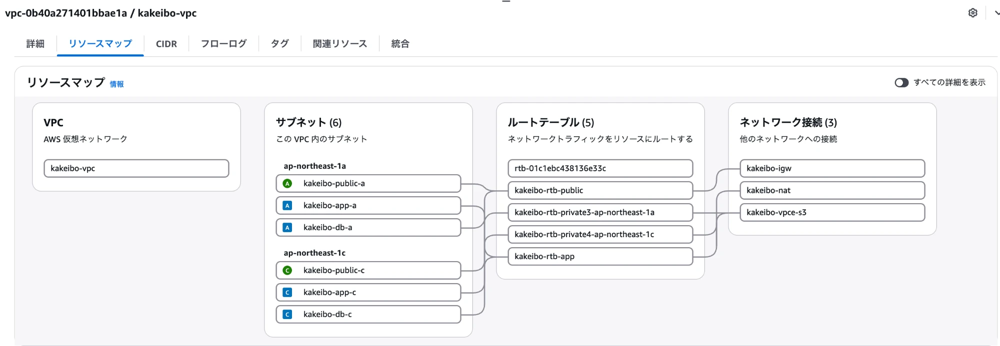

#### 2. ロードバランサーのリソースマップ

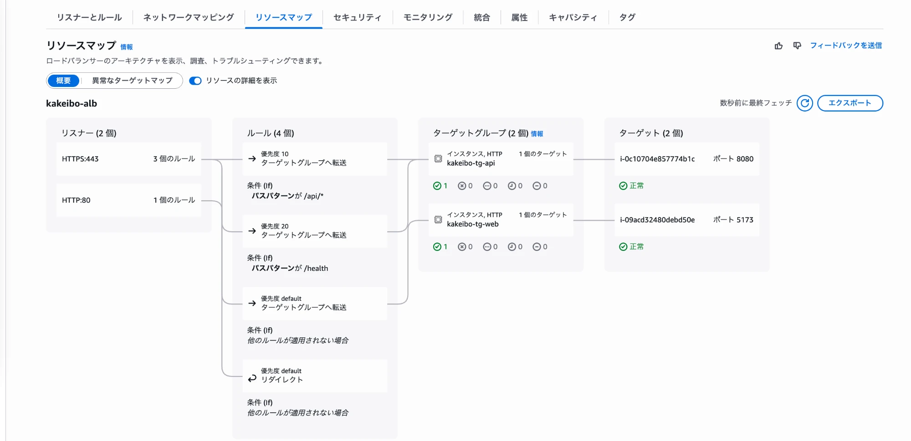

#### 3. Auto Scaling グループの一覧

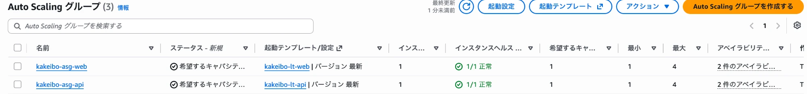

#### 5. RDS のセキュリティグループのルールとレプリケーション

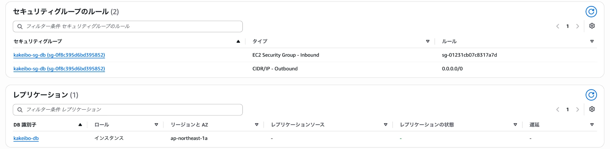

【要記入：4（`kakeibo-sg-db` のインバウンドルール）・5（パブリックアクセス「なし」）・6（Parameter Store の一覧）を撮ったら、ここに足す】

---

## ⑤ まとめ

### 苦労したこと

**ドメインが無いと、動作確認までたどり着けないこと。** Step 7 では、ドメインの取得は講師の回答どおり後回しにしていました。構築の準備で、全画面が Google ログインを前提にしていること、Google が HTTPS のコールバック URL しか受け付けないこと、ALB の既定のドメインには証明書を発行できないことがつながり、ドメインが無いとログインの画面から先に進めないと分かりました。自費でドメインを取り、設計どおり Route 53・ACM・ALB の HTTPS で構築しました。

**初回のマイグレーションと、ヘルスチェックの順番。** API は DB のテーブルが無いと起動できず、テーブルは API のサーバに入ってマイグレーションで作ります。Auto Scaling グループのヘルスチェックを最初から ELB にすると、テーブルを作る前に「異常」と判定されて台が入れ替わり続けます。初回だけヘルスチェックを EC2 にし、マイグレーションのあとに ELB へ切り替えました。

**【要記入：コンソールでの構築中に詰まったところ（例：ユーザーデータが途中で止まった、ターゲットが healthy にならなかった、証明書の検証が終わらなかった、など）と、どう解決したか】**

### 工夫したこと

- **縮小しても、設定を変えるだけで設計の形に戻せるようにした。** サブネットと Auto Scaling グループは最初から 2 つの AZ にまたがる形で作り、台数・RDS の Multi-AZ・NAT の数だけを費用のために減らしました
- **複数台で動かすための保証を DB に持たせた。** ログインの `state` は 1 つの SQL で取り出しと削除を行い、同期の二重起動は部分 UNIQUE インデックスで防ぎます。どの台で処理しても同じ結果になります
- **秘密情報をサーバの外に置いた。** 起動時に Parameter Store から読み、root だけが読めるファイルに書きます。起動のログには値を出さず、フロントのサーバには読む権限を渡していません
- **SSH を使わずに調べられるようにした。** 起動時のログとアプリのログを CloudWatch Logs に送り、サーバに入るときは Session Manager を使います
- **成果物を S3 から NAT を通らずに取る。** 成果物は数十 MB あり、台が起動するたびに取ります。無料のゲートウェイエンドポイントを通して、NAT の通信料がかからないようにしました

### 学んだこと

**「1 台で動かす前提」は、台数を増やすことを考えて初めて見えること。** ローカルの開発では 1 台で動くため、メモリ上の `state` やロックで問題が起きません。Step 7 で Auto Scaling を設計して初めて、ログインや同期が台をまたぐと壊れることに気づきました。複数台の間で守りたい約束は、DB の制約として持たせるのが確実だと学びました。

**外部のサービスの条件が、インフラの構成を決めること。** HTTPS とドメインが必要になったのは、AWS の都合ではなく Google ログインの条件からでした。構成を設計するときは、アプリがつながる外部のサービスの条件も前提に入れる必要があります。

**AWS の費用は「使った量」より「置いてある時間」で決まるものが多いこと。** NAT Gateway・ALB・パブリック IPv4 アドレスは、使わなくても時間で課金されます。止め方と再開の手順を最初に決めておくことで、検証用の環境を安く持てました。

**【要記入：構築を通して自分で気づいたこと】**

---

## メンタリング報告（2.1 提出課題の説明）

| 報告内容 | 対応箇所 |
|---|---|
| Step 7 で設計した構成を実現する過程で苦労した点 | ⑤「苦労したこと」 |
| Step 7 の構成から調整した部分とその理由 | ①「Step 7 から調整した部分」 |
| 構築した構成のメリット | 下記 |
| 構築した構成のデメリット（リスク） | 下記 |

**メリット**

- 費用が設計の約半分（1 日約 3.7 ドル）で、使わないときは約 1 ドルまで下げられる
- 設定を変えるだけで、設計の形（各層 2 台・Multi-AZ・NAT 2 つ）に戻せる。サービスを止めずに戻せる
- 入口が ALB 1 つで、フロントと API が同一オリジン。CORS の設定が要らない
- インターネットから届くのは ALB だけ。サーバと DB は直接届かない場所にあり、SSH も開けていない。秘密情報はサーバの外（Parameter Store）にある
- 新しい版の配布（インスタンスの更新）では止まらない。負荷が上がれば CPU を見て 4 台まで自動で増える

**デメリット（リスク）**

- 各層 1 台のため、**サーバ 1 台の障害で、その層が数分止まる**（Auto Scaling グループが新しい台を起動するまで）
- **AZ-a の障害では、ログインと同期ができなくなる**（NAT Gateway が AZ-a にしか無い）。RDS も AZ-a にあるため、AZ-a が戻るまで DB を使えない
- RDS が単一 AZ のため、DB の障害からの復旧は Multi-AZ（1〜2 分）より長くかかる
- EC2 の OS の更新と、デプロイの手順を自分で持つ必要がある
- 同期は API のサーバの中で動くため、台の入れ替えのときに同期が途中で止まることがある（もう一度同期すれば取り戻せる）

---

## 相談させていただきたいこと

【要記入：あれば。なければこの章を消す】
