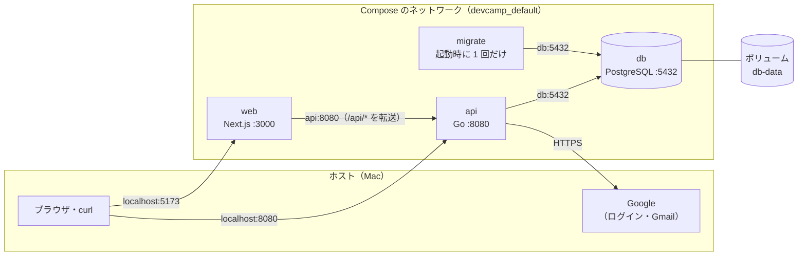

# Step 9 提出物

種別：**スナップショット**（Step 9 提出時点で固定し、以降は更新しない）。その後の変更は、次の Step 以降の提出物の 0 章に記録する

サービス名：決済メール解析による自動家計簿サービス
リポジトリ：<https://github.com/e1lite/devcamp-kakeibo>

| 提出項目 | 場所 |
|---|---|
| 概要 | 本ファイルの ① |
| 実装コード | 本ファイルの ②（[backend/Dockerfile](../backend/Dockerfile)・[frontend/Dockerfile](../frontend/Dockerfile)・[docker-compose.yml](../docker-compose.yml)） |
| 動作確認 | 本ファイルの ③（出力の全文は [step9-verify-output.txt](./step9-verify-output.txt)） |
| まとめ | 本ファイルの ④ |
| メンタリングでの報告 | 本ファイルの最後 |

---

## 0. 前の Step からの変更

| 変更 | 内容 |
|---|---|
| API に `healthcheck` サブコマンドを追加（[backend/cmd/api/healthcheck.go](../backend/cmd/api/healthcheck.go)） | `/app/api healthcheck` で、同じコンテナの API の `GET /health` を呼び、結果を終了コードで返す。実行用のイメージ（distroless）には curl もシェルも無く、Docker のヘルスチェックを書けないため。単体テストあり |
| ローカルでの起動方法を追加 | 「DB だけをコンテナで動かし、API とフロントはホストで動かす」これまでの方法に加え、`docker compose up -d` で一式を起動できるようにした（[README](../README.md)）。これまでの方法もそのまま使える |
| DB のポートの公開先 | ホストの `5433` を、`127.0.0.1` に限って公開する形に変えた（同じ LAN の他の端末から接続できないように） |
| API のタイムゾーンを日本時間に固定 | コンテナの既定のタイムゾーンは UTC のため、API が返す日時が `+09:00` ではなく `Z`（UTC）になっていた。イメージに `TZ=Asia/Tokyo` を入れて、API 仕様書の例と同じ形にそろえた（④ の「苦労したこと」） |

API 仕様・DB のスキーマに変更は無い。

---

## ① 概要

### 構成



| サービス | イメージ | ホストに公開するポート | 役割 |
|---|---|---|---|
| `db` | `postgres:17-alpine` | `127.0.0.1:5433` | PostgreSQL。データは名前付きボリューム `db-data` に置く |
| `migrate` | `kakeibo-api:local`（API と同じ） | なし | マイグレーションを最新まで適用して終了する |
| `api` | `kakeibo-api:local`（[backend/Dockerfile](../backend/Dockerfile)） | `127.0.0.1:8080` | API サーバ。DB には `db:5432` で接続する |
| `web` | `kakeibo-web:local`（[frontend/Dockerfile](../frontend/Dockerfile)） | `127.0.0.1:5173` | Next.js。`/api/*` を `api:8080` に転送する |

`docker compose up -d` の 1 コマンドで、次の順に起動する。

```
db（healthy になるまで待つ）→ migrate（マイグレーションを流して終了）→ api（healthy になるまで待つ）→ web
```

### 特徴・工夫した点

**バックエンドの Dockerfile（必須）**

1. **マルチステージビルドで、実行用のイメージを35 MB に抑えた。** ビルドには Go の公式イメージを使い（ビルド用のステージは 402 MB）を使い、実行用のイメージには、ビルドした実行ファイル 2 つとマイグレーションの SQL だけを入れる
2. **実行用のイメージは distroless の static。** シェルもパッケージマネージャも無く、CA 証明書（Google の API を HTTPS で呼ぶ）とタイムゾーンのデータだけを持つ。`CGO_ENABLED=0` で C のライブラリに依存しない実行ファイルにしたため、libc の無いイメージで動く。root ではなく nonroot ユーザで動かす
3. **1 つのイメージに、API とマイグレーションの 2 つのコマンドを入れた。** Compose ではコマンドを変えて、別のサービス（`api`・`migrate`）として動かす。ビルドは 1 回で済み、API とマイグレーションの版が必ずそろう。Step 10 の ECS でも、同じイメージを一度だけ動かすタスクとして使える
4. **キャッシュが効く順番にした。** `go.mod`・`go.sum` だけを先にコピーして依存を取り、ソースはその後でコピーする。ソースだけを変えたときは、依存を取り直さない。BuildKit のキャッシュマウントで、Go のビルドキャッシュもビルドをまたいで使う
5. **`CMD` を exec 形式（JSON の配列）で書いた。** シェルを挟まないため API サーバが PID 1 になり、`docker compose stop` の SIGTERM を直接受け取る。Step 3 で実装したグレースフル停止（処理中のリクエストを最大 10 秒待つ）がコンテナでも効く
6. **ヘルスチェックは API 自身のサブコマンドで行う（0 章）。** `/health` は DB への疎通も確かめるため、DB に繋がらない API も unhealthy になる
7. **ビルドするマシンの CPU でコンパイルする（`--platform=$BUILDPLATFORM`）。** Go はクロスコンパイルできるため、Arm の Mac で amd64 のイメージを作るときも、コンパイラをエミュレーションで動かさずに済む。Step 10・11 で AWS 向けのイメージを作るときのため
8. **タイムゾーンをイメージで日本時間に固定した（`TZ=Asia/Tokyo`）。** 動かす場所（手元・ECS）のタイムゾーンによって、API が返す日時の形が変わらないようにした

**フロントエンドの Dockerfile（任意。実施した）**

Step 8 では Amplify を使わず、EC2 に Next.js を配った。Step 10 でもコンテナで動かすため、フロントもコンテナ化した。

1. **3 段のマルチステージビルド（依存の取得 → ビルド → 実行用）。** 実行用のイメージには Next.js の standalone 一式だけを入れ、ビルドにしか使わない node_modules（約 500 MB）とソースを持ち込まない（実行用は 294 MB、ビルド用のステージは 1.02 GB）
2. **Node.js は Step 8 と同じ 24.22.2 の Alpine 版。** 3 段とも同じイメージにして、ネイティブモジュール（sharp など）の libc（musl）をそろえた
3. **`/api/*` の転送先はビルド引数で渡す。** Next.js の rewrites の転送先はビルド時に決まり、実行時の環境変数では変えられないため、ビルド引数 `API_ORIGIN`（既定は Compose のサービス名の `http://api:8080`）にした
4. **`HOSTNAME=0.0.0.0` を指定した。** Docker はコンテナ ID を環境変数 `HOSTNAME` に入れ、Next.js の standalone はその値のアドレスで待ち受けるため、すべてのアドレスで待ち受けるよう上書きした

**Docker Compose**

1. **起動の順番を、「起動した」ではなく「使える状態になった」で待つ。** `depends_on` の条件で、DB は `service_healthy`、マイグレーションは `service_completed_successfully`、API は `service_healthy` を待つ。DB の準備前に API が起動して落ちる、テーブルが無いまま API が動く、ということが無い
2. **コンテナどうしは、Compose のネットワークの中でサービス名で通信する**（`api` → `db:5432`、`web` → `api:8080`）。ホストに公開するのは、ブラウザ・curl・手元の開発ツールから使うポートだけで、公開先は `127.0.0.1` に限った
3. **ホストで動かす開発と、URL をそろえた。** Google ログインのコールバック（`http://localhost:8080/...`）とログイン後の戻り先（`http://localhost:5173/...`）が同じになるよう、フロントはコンテナの中の 3000 をホストの 5173 に公開した。Google Cloud の設定を変えずに、コンテナでもログインできる
4. **DB のデータは名前付きボリューム `db-data` に置く。** コンテナを消しても作り直してもデータが残る（③ の 4 で確認）
5. **秘密情報は Compose ファイルに書かない。** Google の認証情報は、ホストの開発と同じ `.env.local`（コミットしない）を `env_file` で読む。Compose ファイルにはローカル開発専用の固定値だけを書く
6. **`.dockerignore` で、ビルドに送るものを絞った。** 手元の node_modules（macOS 用のネイティブモジュールを含む）・`.next`・`.env*` を送らない

---

## ② 実装コード

リポジトリ：<https://github.com/e1lite/devcamp-kakeibo>（`main` ブランチ）

| ファイル | 内容 |
|---|---|
| [backend/Dockerfile](../backend/Dockerfile) | API のイメージ（ビルド → 実行用の 2 段） |
| [frontend/Dockerfile](../frontend/Dockerfile) | フロントのイメージ（依存の取得 → ビルド → 実行用の 3 段） |
| [docker-compose.yml](../docker-compose.yml) | db・migrate・api・web の 4 サービス |
| [backend/.dockerignore](../backend/.dockerignore)・[frontend/.dockerignore](../frontend/.dockerignore) | ビルドに送らないもの |
| [backend/cmd/api/healthcheck.go](../backend/cmd/api/healthcheck.go) | コンテナのヘルスチェック用のサブコマンド |
| [scripts/verify-compose.sh](../scripts/verify-compose.sh) | ③ の動作確認を行うスクリプト |

以下は提出時点のファイルの全文。

<details>
<summary><code>backend/Dockerfile</code>（クリックで開く）</summary>

```dockerfile
# syntax=docker/dockerfile:1
#
# API サーバ（Go）のイメージ。マルチステージビルドで、ビルドに使う Go の環境（約 300 MB）を
# 実行用のイメージに持ち込まない。実行用のイメージには、ビルドした 2 つのコマンドと migrations/ だけを入れる。
#
#   /app/api               API サーバ（既定のコマンド）。`/app/api healthcheck` でヘルスチェック
#   /app/migrate up        マイグレーション（Docker Compose では migrate サービスとして先に 1 回だけ動かす）
#
# ビルド: docker compose build api   （単体なら docker build -t kakeibo-api ./backend）

# ---- 1. ビルド用のステージ -------------------------------------------------------
# ローカル開発と同じ Go 1.27.1。$BUILDPLATFORM（ビルドするマシン）で動かし、
# $TARGETOS / $TARGETARCH 向けにクロスコンパイルする。Arm の Mac で amd64 のイメージを作るときも、
# Go のコンパイラをエミュレーションで動かさずに済む（Step 10・11 で AWS 向けに作るときのため）
FROM --platform=$BUILDPLATFORM golang:1.27.1-alpine3.24 AS build
WORKDIR /src

# 依存の取得を先に行う。go.mod / go.sum が変わらなければ、この層はキャッシュが使われ、
# ソースを変えただけのビルドでは依存を取り直さない
COPY go.mod go.sum ./
RUN --mount=type=cache,target=/go/pkg/mod \
    go mod download

COPY . .

ARG TARGETOS
ARG TARGETARCH
# /health の version に出す値。docker compose build では APP_VERSION（未指定なら dev）を渡す
ARG VERSION=dev
# CGO_ENABLED=0 で C のライブラリに依存しない（静的リンクの）実行ファイルにする。
# そのため、実行用のイメージに libc が無くても動く
RUN --mount=type=cache,target=/go/pkg/mod \
    --mount=type=cache,target=/root/.cache/go-build \
    CGO_ENABLED=0 GOOS=$TARGETOS GOARCH=$TARGETARCH \
      go build -trimpath -ldflags "-s -w -X main.version=${VERSION}" -o /out/api ./cmd/api && \
    CGO_ENABLED=0 GOOS=$TARGETOS GOARCH=$TARGETARCH \
      go build -trimpath -ldflags "-s -w" -o /out/migrate ./cmd/migrate

# ---- 2. 実行用のステージ ---------------------------------------------------------
# distroless の static：シェル・パッケージマネージャを含まず、CA 証明書（Google の API を HTTPS で呼ぶ）と
# タイムゾーンのデータだけを持つ。攻撃に使える道具が無く、脆弱性の対象になるパッケージも少ない。
# :nonroot はユーザ nonroot（UID 65532）で動かす。root で動かさない
FROM gcr.io/distroless/static-debian12:nonroot

WORKDIR /app
# cmd/migrate は作業ディレクトリの migrations/ を読む
COPY migrations ./migrations
COPY --from=build /out/api /out/migrate ./

# TZ：コンテナの既定のタイムゾーンは UTC のため、API が返す日時が「...Z」になる
# （ホストで動かすと「+09:00」。どちらも同じ時刻だが、動かす場所で出力が変わってしまう）。
# API 仕様書の例と同じ +09:00 になるよう、イメージで日本時間に固定する。どこで動かしても同じになる
ENV APP_ENV=production \
    PORT=8080 \
    TZ=Asia/Tokyo
EXPOSE 8080
USER nonroot:nonroot

# exec 形式（JSON の配列）で書く。シェルを挟まないため API サーバが PID 1 になり、
# docker compose stop の SIGTERM を直接受け取ってグレースフルに停止できる
CMD ["/app/api"]
```

</details>

<details>
<summary><code>frontend/Dockerfile</code>（クリックで開く）</summary>

```dockerfile
# syntax=docker/dockerfile:1
#
# フロントエンド（Next.js）のイメージ。マルチステージビルドで、ビルドにだけ使う node_modules（約 500 MB）と
# ソースを実行用のイメージに持ち込まない。実行用のイメージには Next.js の standalone 一式だけを入れる
# （next.config.ts の output: "standalone"。Step 8 で EC2 に配ったものと同じ中身）。
#
# ビルド: docker compose build web

# Step 8 と同じ Node.js 24 LTS（24.22.2）。Alpine 版で、実行用のイメージを小さくする。
# 3 つのステージで同じイメージを使い、ネイティブモジュール（sharp など）の libc（musl）をそろえる
ARG NODE_IMAGE=node:24.22.2-alpine3.24

# ---- 1. 依存の取得 ---------------------------------------------------------------
# package.json / package-lock.json が変わらなければ、この層のキャッシュが使われ npm ci を省ける
FROM ${NODE_IMAGE} AS deps
WORKDIR /app
COPY package.json package-lock.json ./
RUN --mount=type=cache,target=/root/.npm \
    npm ci --no-audit --no-fund

# ---- 2. ビルド -------------------------------------------------------------------
FROM ${NODE_IMAGE} AS build
WORKDIR /app
ENV NEXT_TELEMETRY_DISABLED=1
# /api/* の転送先（next.config.ts の rewrites）。rewrites はビルド時に決まり、
# 実行時に環境変数で変えられないため、ビルド引数で渡す。
# 既定値は Docker Compose のネットワーク内での API のサービス名
ARG API_ORIGIN=http://api:8080
ENV API_ORIGIN=${API_ORIGIN}
COPY --from=deps /app/node_modules ./node_modules
COPY . .
# public/ は今は空でリポジトリに無いため、作っておく（次のステージの COPY が失敗しないように）
RUN mkdir -p public && npm run build

# ---- 3. 実行用 -------------------------------------------------------------------
FROM ${NODE_IMAGE} AS runtime
WORKDIR /app
# HOSTNAME：Docker はコンテナ ID を HOSTNAME に入れる。Next.js の standalone はこの値のアドレスで
# 待ち受けるため、0.0.0.0（すべてのアドレス）にしておく
ENV NODE_ENV=production \
    NEXT_TELEMETRY_DISABLED=1 \
    PORT=3000 \
    HOSTNAME=0.0.0.0
# standalone の server.js は public と .next/static を含まないため、横に置く（Next.js の output の説明どおり）
COPY --from=build --chown=node:node /app/.next/standalone ./
COPY --from=build --chown=node:node /app/.next/static ./.next/static
COPY --from=build --chown=node:node /app/public ./public

# イメージに用意されているユーザ node（UID 1000）で動かす。root で動かさない
USER node
EXPOSE 3000
CMD ["node", "server.js"]
```

</details>

<details>
<summary><code>docker-compose.yml</code>（クリックで開く）</summary>

```yaml
# API・フロントエンド・DB をローカルでまとめて起動する（Step 9）。
#
#   docker compose up -d          一式を起動する（初回はイメージのビルドから行うため数分かかる）
#   docker compose ps -a          状態を見る（migrate は「Exited (0)」= マイグレーションが成功して終了、で正常）
#   docker compose logs -f api    API のログを見る
#   docker compose up -d --build  コードを変えたあと、イメージを作り直して入れ替える
#   docker compose down           止めてコンテナを消す（DB のデータはボリューム db-data に残る）
#
# 起動したら http://localhost:5173 を開き、Google でログインする（.env.local に Google の認証情報が要る。README 参照）。
#
# 初回の up では「pull access denied for kakeibo-api（kakeibo-web）」と表示されるが、問題ない。
# image と build の両方を書いたサービスは、手元にイメージが無いとまずレジストリから取ろうとし、
# 見つからなければ手元でビルドする（Compose の既定の動き）。イメージができたあとは表示されない。
#
# 起動の順番は depends_on で決める:
#   db（healthy になるまで待つ）→ migrate（マイグレーションを流して終了）→ api（healthy になるまで待つ）→ web
#
# コンテナどうしは、Compose がこのプロジェクト用に作るネットワークの中で、サービス名で通信する
# （api → db:5432、web → api:8080）。ホストに公開するポートは、ブラウザ・curl・手元の開発ツールから使うものだけにし、
# 同じネットワーク（社内 LAN など）の他の端末から接続されないよう 127.0.0.1 に限る。
#
# DB だけをコンテナで動かす従来の開発（make db-up → make run・npm run dev）もそのまま使える。
# その場合は api・web を起動しない（ホストのポート 8080・5173 がぶつかる）。

# API とマイグレーションの接続先。コンテナの中から見た DB は「db:5432」（ホストの 5433 ではない）
x-database-url: &database-url "postgres://kakeibo:kakeibo@db:5432/kakeibo?sslmode=disable"

services:
  db:
    image: postgres:17-alpine
    container_name: devcamp-kakeibo-db
    environment:
      POSTGRES_USER: kakeibo
      POSTGRES_PASSWORD: kakeibo
      POSTGRES_DB: kakeibo
      TZ: Asia/Tokyo
    ports:
      # ホスト側は 5433。ローカルに PostgreSQL が入っていても衝突しないようにする。
      # ホストで動かす make run・make test が使う。コンテナからは使わない
      - "127.0.0.1:5433:5432"
    volumes:
      # データはコンテナの外（名前付きボリューム）に置く。コンテナを消しても作り直しても残る
      - db-data:/var/lib/postgresql/data
    healthcheck:
      # migrate / test はこのヘルスチェックが通ってから実行する
      test: ["CMD-SHELL", "pg_isready -U kakeibo -d kakeibo"]
      interval: 3s
      timeout: 3s
      retries: 20

  # マイグレーションを最新まで適用して終了する。API と同じイメージを、コマンドを変えて動かす
  migrate:
    image: kakeibo-api:local
    # イメージは api サービスのビルドで作る。Docker Hub から取りに行かない
    pull_policy: never
    command: ["/app/migrate", "up"]
    environment:
      DATABASE_URL: *database-url
    depends_on:
      db:
        condition: service_healthy

  api:
    build:
      context: ./backend
      args:
        # /health の version に出す値。例: APP_VERSION=$(git rev-parse --short HEAD) docker compose build
        VERSION: ${APP_VERSION:-dev}
    image: kakeibo-api:local
    env_file:
      # Google OAuth のクライアント ID・シークレット（make run と同じファイル。コミットしない）。
      # 無くても起動の確認はできるよう必須にはしない（その場合は API が設定不足のエラーで止まる）
      - path: ./.env.local
        required: false
    environment:
      # 下の値は .env.local より優先される
      APP_ENV: local
      DATABASE_URL: *database-url
      # ローカル開発専用の固定値（Makefile と同じ。make run で発行したトークンもそのまま使える）。
      # 本番（Step 8・10）は Parameter Store の別の値を渡す
      JWT_SECRET: local-development-secret-do-not-use-in-production
      MAIL_CREDENTIAL_KEY: C7oh0wLD8ZFO/46uHGBB6OGTzF4EyHFSkEYFgGcrboo=
      # Google のコールバック（localhost:8080）とログイン後の戻り先（localhost:5173）は、
      # API の既定値がこの構成の公開ポートと一致するため指定しない（README の「設定」）
    ports:
      # ブラウザと curl から使う。Google のログインのコールバック先（http://localhost:8080/...）でもある
      - "127.0.0.1:8080:8080"
    depends_on:
      migrate:
        condition: service_completed_successfully
    healthcheck:
      # API サーバ自身の /health（DB への疎通を含む）を呼ぶ。実行用のイメージに curl が無いため
      test: ["CMD", "/app/api", "healthcheck"]
      interval: 10s
      timeout: 5s
      retries: 3
      start_period: 10s
      start_interval: 1s

  web:
    build:
      context: ./frontend
      args:
        # Next.js が /api/* を転送する先。Compose のネットワークの中の API のサービス名
        API_ORIGIN: http://api:8080
    image: kakeibo-web:local
    ports:
      # ブラウザから開く。Google のログイン後の戻り先（http://localhost:5173/auth/callback）と合わせる
      - "127.0.0.1:5173:3000"
    depends_on:
      api:
        condition: service_healthy
    healthcheck:
      test: ["CMD", "wget", "-q", "--spider", "http://127.0.0.1:3000/login"]
      interval: 30s
      timeout: 5s
      retries: 3
      start_period: 10s
      start_interval: 1s

volumes:
  db-data:
```

</details>

---

## ③ 動作確認

### 確認の方法

実行環境：macOS（Apple Silicon）、Docker Compose v5.5.1

```bash
docker compose up -d                  # 一式を起動する（初回はイメージのビルドから）
# ブラウザで http://localhost:5173 を開き、Google でログインして、トークンを .token に保存する
./scripts/verify-compose.sh 2>&1 | tee docs/step9-verify-output.txt
```

スクリプトは、いったんコンテナを消してから `docker compose up -d` で起動し直し、起動から確かめる（DB のボリュームは消さない）。

このアプリのユーザ登録は Google ログイン（API-002・API-003。ブラウザで Google の画面を操作する）で行う。そのため、curl での書き込みの確認には**取引の登録（API-011 `POST /api/v1/transactions`）**を使った。curl に付けるトークンは、コンテナで起動したフロントからログインして取った（このログインで、API のコンテナから DB の `users` テーブルへの書き込みも起きている）。

| # | 確認 | 方法 | 結果 |
|---|---|---|---|
| 0 | 一式が起動する | `docker compose up -d` → `docker compose ps -a` | OK。db・api・web が healthy、migrate が Exited (0) |
| 1 | 疎通確認 | `GET /health`（API-001）。フロントのコンテナから `api:8080` でも呼ぶ | OK。200 で `status`・`database` とも `ok`。フロントのコンテナからも届く |
| 2 | 書き込み確認 | `POST /api/v1/transactions`（API-011）→ DB のコンテナの psql で行を確認 | OK。201 で登録され、`transactions` に 1 行入った |
| 3 | 読み取り確認 | `GET /api/v1/transactions/{id}`（API-012）。API に直接と、フロントのコンテナ経由の 2 通り | OK。どちらも 200 で、登録した金額・メモが返る |
| 4 | （追加）データが残る | `docker compose down` → `up -d` で作り直したあとに、同じ取引を取得 | OK。200 で同じ内容が返る |

最後に、登録した取引を削除した（API-014）。出力の全文は [step9-verify-output.txt](./step9-verify-output.txt)。以下は抜粋。

### 0. `docker compose up -d` で一式が起動する

起動の順番（db が Healthy → migrate が Exited → api が Healthy → web）と、各コンテナの状態・イメージのサイズ。

```
$ docker compose up -d
 Network devcamp_default Creating 
 Network devcamp_default Creating 
 Network devcamp_default Created 
 Network devcamp_default Created 
 Container devcamp-kakeibo-db Creating 
 Container devcamp-kakeibo-db Created 
 Container devcamp-migrate-1 Creating 
 Container devcamp-migrate-1 Created 
 Container devcamp-api-1 Creating 
 Container devcamp-api-1 Created 
 Container devcamp-web-1 Creating 
 Container devcamp-web-1 Created 
 Container devcamp-kakeibo-db Starting 
 Container devcamp-kakeibo-db Started 
 Container devcamp-kakeibo-db Waiting 
 Container devcamp-kakeibo-db Healthy 
 Container devcamp-migrate-1 Starting 
 Container devcamp-migrate-1 Started 
 Container devcamp-migrate-1 Waiting 
 Container devcamp-migrate-1 Exited 
 Container devcamp-api-1 Starting 
 Container devcamp-api-1 Started 
 Container devcamp-api-1 Waiting 
 Container devcamp-api-1 Healthy 
 Container devcamp-web-1 Starting 
 Container devcamp-web-1 Started 

$ docker compose ps -a --format table {{.Service}}\t{{.Image}}\t{{.Status}}\t{{.Ports}}
SERVICE   IMAGE                STATUS                     PORTS
api       kakeibo-api:local    Up 2 seconds (healthy)     127.0.0.1:8080->8080/tcp
db        postgres:17-alpine   Up 7 seconds (healthy)     127.0.0.1:5433->5432/tcp
migrate   kakeibo-api:local    Exited (0) 3 seconds ago   
web       kakeibo-web:local    Up 1 second (healthy)      127.0.0.1:5173->3000/tcp

# migrate は、マイグレーションを流して終了したコンテナ（Exited (0) なら成功）
$ docker compose logs --no-log-prefix migrate
2026/11/23 21:24:53 適用すべきマイグレーションはありません

# イメージのサイズ。比較のため、ビルド用のステージだけを取り出したイメージも作る（ビルドのキャッシュが効く）
$ docker image ls --filter reference=kakeibo-* --format table {{.Repository}}:{{.Tag}}\t{{.Size}}
REPOSITORY:TAG            SIZE
kakeibo-web:build-stage   1.02GB
kakeibo-web:local         294MB
kakeibo-api:build-stage   402MB
kakeibo-api:local         35MB
```

### 1. 疎通確認

```
# API-001 ヘルスチェック（ホスト → api:8080）。DB への疎通も確かめて 200 を返す
$ curl http://localhost:8080/health    # Authorization ヘッダなし
{"data":{"status":"ok","version":"dev","database":"ok","checked_at":"2026-11-23T21:25:08+09:00"}}
=> 200 OK
   => data.status=ok OK
   => data.database=ok OK

# フロントのコンテナから、サービス名 api で API に届くこと（Compose のネットワークの名前解決）
$ docker compose exec -T web wget -qO- http://api:8080/health
{"data":{"status":"ok","version":"dev","database":"ok","checked_at":"2026-11-23T21:25:08+09:00"}}
```

### 2. 書き込み確認

API が返した ID の行が、DB のコンテナの `transactions` テーブルに入っている。

```
# API-011 取引を登録する
$ curl -X POST http://localhost:8080/api/v1/transactions -d '{"occurred_at":"2026-11-23T21:25:08+09:00","amount_minor":980,"note":"Step 9 docker compose の書き込み確認"}'
{"data":{"id":438,"occurred_at":"2026-11-23T21:25:08+09:00","amount_minor":980,"currency":"JPY","merchant":null,"category":null,"payment_method":null,"source":"manual","status":"confirmed","is_possible_duplicate":false,"event_count":0,"amount_jpy_minor":980,"category_source":"default","is_user_edited":true,"note":"Step 9 docker compose の書き込み確認","payment_events":[]}}
=> 201 OK

登録した取引の ID: 438

# DB のコンテナの psql で、transactions テーブルに行が入ったことを確かめる
$ docker compose exec -T db psql -U kakeibo -d kakeibo -c SELECT id, occurred_at, amount_minor, source, note, deleted_at FROM transactions WHERE id = 438;
 id  |      occurred_at       | amount_minor | source |                 note                 | deleted_at 
-----+------------------------+--------------+--------+--------------------------------------+------------
 438 | 2026-11-23 21:25:08+09 |          980 | manual | Step 9 docker compose の書き込み確認 | 
(1 row)

   => DB の行数（id = 438、削除されていない）=1 OK
```

### 3. 読み取り確認

```
# API-012 登録した取引を取得する（ホスト → api:8080 → db:5432）
$ curl -X GET http://localhost:8080/api/v1/transactions/438
{"data":{"id":438,"occurred_at":"2026-11-23T21:25:08+09:00","amount_minor":980,"currency":"JPY","merchant":null,"category":null,"payment_method":null,"source":"manual","status":"confirmed","is_possible_duplicate":false,"event_count":0,"amount_jpy_minor":980,"category_source":"default","is_user_edited":true,"note":"Step 9 docker compose の書き込み確認","payment_events":[]}}
=> 200 OK
   => amount_minor=980 OK
   => note=Step 9 docker compose の書き込み確認 OK
   => source=manual OK
--------------------------------------------------------------------
# フロントのコンテナ経由で同じ取引を取得する（ホスト → web:3000 → api:8080 → db:5432）
$ curl -X GET http://localhost:5173/api/v1/transactions/438
{"data":{"id":438,"occurred_at":"2026-11-23T21:25:08+09:00","amount_minor":980,"currency":"JPY","merchant":null,"category":null,"payment_method":null,"source":"manual","status":"confirmed","is_possible_duplicate":false,"event_count":0,"amount_jpy_minor":980,"category_source":"default","is_user_edited":true,"note":"Step 9 docker compose の書き込み確認","payment_events":[]}}
=> 200 OK
   => amount_minor=980 OK
```

### 4. コンテナを作り直しても、DB のデータが残る

`docker compose down` でコンテナとネットワークを消し、`docker compose up -d` で作り直したあとも、ボリュームに残った取引を読める（down・up の出力は 0 と同じため省略）。

```
$ docker volume ls --filter name=db-data
DRIVER    VOLUME NAME
local     devcamp_db-data

$ docker compose down
（省略）

$ docker compose up -d
（省略）

$ docker compose ps -a --format table {{.Service}}\t{{.Image}}\t{{.Status}}\t{{.Ports}}
SERVICE   IMAGE                STATUS                     PORTS
api       kakeibo-api:local    Up 2 seconds (healthy)     127.0.0.1:8080->8080/tcp
db        postgres:17-alpine   Up 7 seconds (healthy)     127.0.0.1:5433->5432/tcp
migrate   kakeibo-api:local    Exited (0) 3 seconds ago   
web       kakeibo-web:local    Up 1 second (healthy)      127.0.0.1:5173->3000/tcp

--------------------------------------------------------------------
# 作り直したコンテナで、登録した取引を取得する
$ curl -X GET http://localhost:8080/api/v1/transactions/438
{"data":{"id":438,"occurred_at":"2026-11-23T21:25:08+09:00","amount_minor":980,"currency":"JPY","merchant":null,"category":null,"payment_method":null,"source":"manual","status":"confirmed","is_possible_duplicate":false,"event_count":0,"amount_jpy_minor":980,"category_source":"default","is_user_edited":true,"note":"Step 9 docker compose の書き込み確認","payment_events":[]}}
=> 200 OK
   => amount_minor=980 OK
   => note=Step 9 docker compose の書き込み確認 OK
```

最後に登録した取引を削除し（204）、削除後は 404 になることを確かめた。結果は次のとおり。

```
====================================================================
 成功: 16 件 / 失敗: 0 件
====================================================================
```

---

## ④ まとめ

### 苦労したこと

**動かす場所が変わると、API が返す日時の形が変わったこと。** 動作確認で、`+09:00` を付けて登録した取引の日時が、API からは `2026-11-23T12:20:58Z`（UTC）で返ってきました。ホストで動かしていたとき（Step 3）は `+09:00` でした。コンテナの既定のタイムゾーンが UTC で、Go は日時を動いている環境のタイムゾーンで出力するためです。同じ時刻を表しており、API 仕様（オフセットを必ず含む）にも反しておらず、画面はフロントで日本時間に直して表示するため影響はありませんでした。それでも、動かす場所で出力が変わるのは、コンテナ化で無くしたかった環境の違いそのものです。イメージに `TZ=Asia/Tokyo` を入れ、どこで動かしても API 仕様書の例と同じ `+09:00` になるようにしました。振り返ると、Step 8 の EC2（UTC）でも同じことが起きていました。

**コンテナの中の `localhost` は、そのコンテナ自身を指すこと。** ホストで API を動かしていたときの DB の接続先は `localhost:5433` でした。これをそのまま API のコンテナに渡すと、API は自分自身の 5433 に繋ごうとして失敗します。コンテナの中からは、サービス名とコンテナ側のポート（`db:5432`）で繋ぐ必要があります。同じ「DB の接続先」でも、どこから見るかで値が変わるため、Compose ファイルでは「ホストから使うポート」と「コンテナどうしで使うポート」を分けて書き、コメントを付けました。

**Next.js の rewrites の転送先が、実行時に変えられないこと。** フロントは `/api/*` を API へ転送しており、転送先は環境変数 `API_ORIGIN` で決めています。開発サーバ（`next dev`）では実行時に変えられますが、standalone のビルドでは転送先がビルド時に固定されます。そのため、コンテナでは実行時の環境変数ではなく、ビルド引数で `http://api:8080` を渡す形にしました。

**実行用のイメージを小さくすると、調べる道具も無くなること。** distroless のイメージには curl もシェルも無いため、Docker のヘルスチェックを curl で書けず、`docker compose exec` で中に入って調べることもできません。ヘルスチェックは API 自身のサブコマンドで行い、調べるときはログ（`docker compose logs`）を見る形にしました。

### 工夫したこと

- **Step 10 の AWS でもそのまま使えるイメージにした。** 環境ごとに違う値（DB の接続先・秘密情報・URL）はイメージに入れず、実行時に環境変数で渡します。マイグレーションも同じイメージに入れました
- **イメージを小さく、安全にした。** マルチステージビルドでビルドの道具を持ち込まず、実行用は distroless・Alpine にし、どちらも root で動かしません（① の特徴）
- **起動の順番を、ヘルスチェックで「使える状態になった」ことで待つ。** `docker compose up -d` だけで、DB の準備・マイグレーション・API・フロントの順に起動します
- **これまでの開発の手順と、Google の設定を変えずに使えるようにした。** ホストのポートと URL をそろえ、`.env.local` も同じものを使います

### 学んだこと

**イメージに入れるものと、実行時に渡すものを分けること。** コンパイラ・node_modules のような「作るための道具」は実行には要らず、入れるほどイメージが大きくなり、攻撃に使える道具も増えます。また、DB の接続先や秘密情報のように環境ごとに違う値をイメージに入れると、環境ごとにイメージを作り直すことになります。イメージには「どこでも同じもの」だけを入れ、違うものは実行時に渡すことで、同じイメージを手元・CI・AWS で使い回せると学びました。

**環境の違いは、コードの外にもあること。** 「環境に依存しない」というと、ライブラリや実行環境の版をそろえることを考えていました。実際に動かすと、タイムゾーンのように OS の設定として持っている値も、アプリの出力を変えていました。何がアプリの外から入ってきているか（環境変数・タイムゾーン・ホスト名など）を意識し、必要なものはイメージに固定することが大事だと学びました。

**「起動した」と「使える」は違うこと。** DB のコンテナが起動しても、すぐには接続を受け付けません。`depends_on` だけでは起動の順番しか決まらないため、ヘルスチェックと組み合わせて「使える状態になった」ことを待つ必要があります。ALB のヘルスチェック（Step 8）と同じ考え方が、コンテナの起動の順番にも要ると分かりました。

**コンテナは使い捨てで、残したいデータは外に置くこと。** コンテナを消すと、中で書き込んだファイルも消えます。DB のデータをボリュームに置いたことで、コンテナを作り直してもデータが残ることを確かめられました（③ の 4）。Step 10 では、このボリュームの役割を RDS が担います。

---

## メンタリングでの報告

### 1. 講座の振り返り

#### コンテナ

- **概要**：アプリと、動かすのに必要なもの（ライブラリ・設定・実行環境）をまとめて、ホストの OS の上で隔離して動かす仕組み。カーネルはホストと共有し、プロセス・ファイル・ネットワークを分ける。仮想マシンと違って OS を丸ごと起動しないため、軽く、数秒で起動する
- **何ができるのか**：「手元では動くのに」という環境の違いを無くせる。同じイメージを手元・CI・本番で動かせる。1 台の上で、互いに干渉させずに複数のアプリを動かせる。使い捨てにでき、作り直すのが簡単
- **使うときに気をつけるべきこと**：コンテナの中に書いたファイルは、コンテナを消すと消える（残すデータはボリュームや DB へ）。1 つのコンテナには 1 つの役割を持たせる。root で動かさない。カーネルを共有するため、仮想マシンほど強い隔離ではない。Mac の Docker は裏で Linux の仮想マシンを動かしており、CPU（arm64）が本番（amd64 のこともある）と違うことがある
- **本課題では**：db・migrate・api・web の 4 つのコンテナに分けた

#### Dockerfile

- **概要**：イメージの作り方を書いたテキストファイル。`FROM`（土台のイメージ）・`COPY`・`RUN`・`ENV`・`USER`・`CMD` などの命令を上から順に実行し、命令ごとに層（レイヤ）ができる
- **何ができるのか**：イメージの作り方をコードとして残し、誰がどこで作っても同じイメージにできる（Git で差分を見られ、CI で自動で作れる）。層ごとにキャッシュされ、変わった層から下だけを作り直せる
- **使うときに気をつけるべきこと**：命令の順番がキャッシュの効き方を決める（変わりにくい依存を先に、変わりやすいソースを後に）。秘密情報を `COPY`・`ENV`・`ARG` で入れない（層やイメージの履歴に残る）。`.dockerignore` で送るものを絞る。土台のイメージは版を固定する（`latest` にしない）。`CMD` は exec 形式で書く（シェル形式だとシグナルがアプリに届かない）
- **本課題では**：`go.mod`・`package-lock.json` を先にコピーして依存を取り、ソースを後にコピーした。土台のイメージは `golang:1.27.1-alpine3.24`・`node:24.22.2-alpine3.24` のように版を固定した

#### マルチステージビルド

- **概要**：1 つの Dockerfile に `FROM` を複数書き、前のステージで作ったものだけを `COPY --from` で次のステージに渡す書き方
- **何ができるのか**：コンパイラ・node_modules・ソースなどのビルドの道具を実行用のイメージに入れず、小さく安全なイメージにできる。ステージを `--target` で選び、ビルドの途中のイメージやテスト用のイメージを同じファイルから作れる
- **使うときに気をつけるべきこと**：実行に要るファイルの持ち込み漏れ（本課題では、マイグレーションの SQL、Next.js の `public` と `.next/static`）。ビルドと実行で libc や CPU をそろえる（ネイティブモジュールが動かなくなる）。実行用のイメージにはシェルや調べる道具が無いことがあるため、調べ方（ログ・ヘルスチェック）を別に用意する
- **本課題では**：API は 35 MB（ビルド用のステージは 402 MB）、フロントは 294 MB（ビルド用のステージは 1.02 GB）

#### Docker ネットワーク

- **概要**：コンテナどうし、コンテナとホストをつなぐ仮想のネットワーク。既定は bridge。Compose はプロジェクトごとにネットワークを作り、その中ではサービス名で相手を見つけられる（Docker の中の DNS）
- **何ができるのか**：IP アドレスを意識せず、名前でコンテナどうしをつなげる。ポートの公開（`ports`）で、必要なポートだけをホストに出せる。ネットワークを分けて、届く範囲を限れる
- **使うときに気をつけるべきこと**：コンテナの中の `localhost` はそのコンテナ自身。`ports` で公開すると、既定では `0.0.0.0`（同じ LAN の他の端末からも届く）になる。コンテナどうしの通信にポートの公開は要らず、コンテナ側のポートを使う（本課題では `db:5432`。ホストの `5433` ではない）。名前で届くのは同じネットワークの中だけ
- **本課題では**：`api` → `db:5432`、`web` → `api:8080` をサービス名でつなぎ、ホストへの公開は `127.0.0.1` に限った

#### Docker ストレージ

- **概要**：コンテナのファイルは、イメージの読み取り専用の層の上に、書き込み用の層を重ねたもの。書き込み用の層はコンテナを消すと消える。残したいデータは、ボリューム（Docker が管理する場所）・バインドマウント（ホストのディレクトリ）・tmpfs（メモリ）でコンテナの外に置く
- **何ができるのか**：DB のデータのように、コンテナを作り直しても残したいものを保てる。ホストのソースをマウントして、開発中の変更をすぐに反映できる。コンテナどうしでデータを共有できる
- **使うときに気をつけるべきこと**：`docker compose down -v` やボリュームの削除で、データが消える。バインドマウントはホストのパスやファイルの持ち主（UID）に左右される。ボリュームはそのホストにしか無いため、複数台やクラウドでは RDS のようなマネージドなストレージを使う。バックアップは別に考える必要がある
- **本課題では**：DB のデータを名前付きボリューム `db-data` に置き、コンテナを作り直しても残ることを確かめた（③ の 4）

#### Docker Compose

- **概要**：複数のコンテナ（サービス）・ネットワーク・ボリュームを 1 つの YAML ファイル（`docker-compose.yml`）に書き、まとめて起動・停止するツール
- **何ができるのか**：`docker compose up -d` の 1 コマンドで一式を起動できる。起動の順番・環境変数・ポート・ボリューム・ヘルスチェックを 1 つのファイルで管理し、チームで同じ環境を共有できる
- **使うときに気をつけるべきこと**：`depends_on` だけでは起動の順番しか決まらず、「使える状態」を待たない（`condition: service_healthy` などを使う）。秘密情報を YAML に直接書かない（`env_file` と `.gitignore`）。コードを変えてもイメージは自動で作り直されない（`--build` が要る）。1 台のホスト向けの道具で、本番の複数台・自動復旧・スケールには ECS や Kubernetes を使う
- **本課題では**：db → migrate → api → web の順番を、ヘルスチェックと `service_completed_successfully` で待つようにした

### 2. 提出課題の説明

| 報告内容 | 対応箇所 |
|---|---|
| どのような設計意図でコンテナ化したのか | 下記と、① の「特徴・工夫した点」 |
| コンテナ間の連携をどのように組み立てたのか | ① の「構成」と、Docker Compose の 1〜3 |
| 実装中に工夫したこと・苦労したこと | ④ |

**設計意図**

1. **Step 10 の AWS（ECS）でそのまま使えるイメージにする。** 環境ごとに違う値はイメージに入れず、実行時に環境変数で渡す。マイグレーションも同じイメージで動かす
2. **小さく、安全にする。** ビルドの道具を持ち込まず、シェルの無いイメージ（API）や小さいイメージ（フロント）を使い、root で動かさない
3. **これまでの開発の手順を壊さない。** Google ログインの URL・`.env.local`・`make run` などはそのまま使え、コンテナで一式を動かす方法を追加した

### 次の Step（10）に向けて

- 同じイメージを ECR に置き、ECS で動かす。秘密情報は Compose の `.env.local` の代わりに、タスク定義から Parameter Store の値を渡す
- マイグレーションは、同じイメージの `/app/migrate up` を一度だけ動かすタスクとして実行する
- ALB が `/api/*` を API に振り分けるため、フロントの rewrites（`API_ORIGIN`）は本番では使われない
- CPU（Arm / x86）を決める。Step 8 の EC2 は Arm（t4g）だった。API はクロスコンパイルで安く作れるが、フロントを x86 の CI（Step 11 の GitHub Actions）で Arm 向けに作るとエミュレーションで遅くなる
